# LittleStory iOS — High-level design

**Status:** Draft v0.2 for owner review · 11 Nov 2026 (v0.2: iPhone + iPad universal app, exact latest versions, minimum iOS 26)
**Scope:** the native iOS app for LittleStory, in a new repository (proposed name `LittleStory-iOS`).
**Companion:** [Low-level design](low-level-design.md) (classes, files, data, sequences).
**Reference:** the Android app (`shivayogih/LittleStory`, `development` @ `5c505c6`) and its HLD/LLD. The iOS app copies the product, the screens, the content and the rules, not the Kotlin code.

---

## 0. Summary in eleven points

1. **Native Swift 6.4 + SwiftUI** app, built with **Xcode 27.2** against the **iOS 27.2 SDK**, minimum **iOS / iPadOS 26**. No cross-platform framework (decided 11 Nov 2026, §3).
2. **Clean, layered architecture**: Presentation → Domain → Data, with the Domain layer as pure Swift that knows nothing about UI, storage or the network.
3. **SOLID** throughout: every dependency is a Swift protocol, one composition root wires real or mock implementations, and each type has one job.
4. **Modular**: one local Swift package (`LittleStoryKit`) with a target per layer and per feature, mirroring the Android modules one for one. A feature can never import another feature or the Data layer.
5. **Same product as Android**: 21 screens, five tabs, the same flows, the same mock stories in **English and Kannada**, the same parental gate.
6. **Zero paid services**: no backend, no AI API, no analytics, no ads, no paid SDKs. Every dependency is first-party Apple or free open source.
7. **AI is mocked**: story writing, narration, pictures, downloads and subscription are deterministic simulations behind protocols, labelled in the UI, and swappable later without touching screens.
8. **Languages are data**: English is default and fallback, Kannada is complete, and a new language is one registry entry plus translation files.
9. **Quality gates from day one**: Swift Testing unit tests, snapshot tests in EN / KN / largest Dynamic Type, UI tests, SwiftLint, SwiftFormat, a hardcoding check and a translation check, all run by GitHub Actions on every pull request.
10. **One universal app for iPhone and iPad**: every screen adapts to compact and regular widths, portrait and landscape, iPad split screen and freely resized windows (§6A).
11. **Child safety first**: all data stays on the device, no tracking, a parental gate before parent-only screens, and a privacy manifest, so the app can later qualify for the App Store Kids category.

---

## 1. What the app is

LittleStory is a storytelling app for children aged 3–12 and their parents. A family browses a bundled catalogue of stories, creates a personalised story from a few words about the child's day, reads it page by page or listens to it in a narration player, and manages child profiles, language and parent settings.

| In the iOS MVP | Not in the iOS MVP |
| --- | --- |
| Swift 6, SwiftUI, Observation, Swift Concurrency | Real AI provider, backend, sign-in, cloud sync |
| 21 screens, same as Android (§6) | Real payments (StoreKit purchases), real push notifications |
| Mock content in English and Kannada (same JSON as Android) | Analytics, crash-reporting SaaS, advertising |
| Simulated story generation, narration, downloads, subscription | Any network call; the app has no server to call |
| Local storage: SwiftData + UserDefaults | Accounts, login/logout (follows the Android plan in PR #20) |
| Parental gate before parent-only screens | Widgets, Apple Watch, Mac and Vision Pro builds |
| **Universal app: iPhone and iPad**, portrait and landscape, iPad split screen and resizable windows (§6A) | Store submission (owner only, and it needs a paid account, §12) |

---

## 2. System context

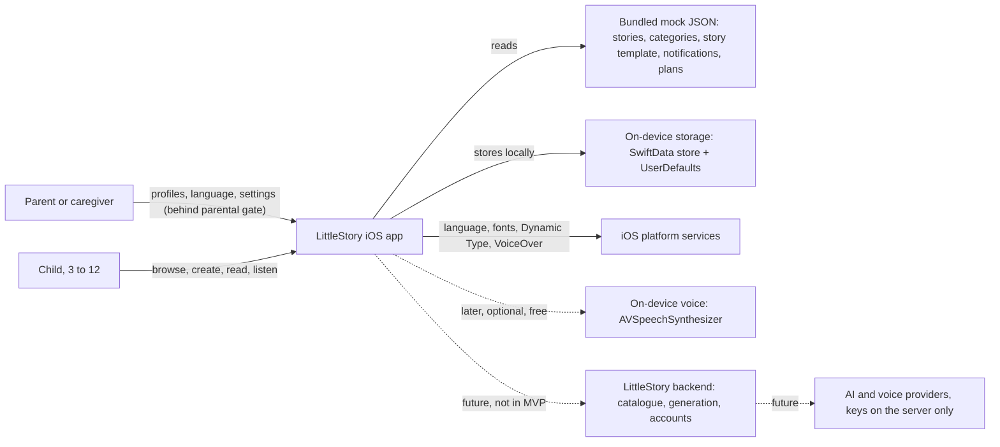

- Solid lines exist in the MVP. Dotted lines are replacement points only.
- The app holds no API keys and makes no network requests (the same rule as Android NFR-07).

---

## 3. Key decision: native SwiftUI or Kotlin/Compose Multiplatform?

### 3.1 Options

| | A. Native Swift + SwiftUI (recommended) | B. Kotlin Multiplatform (shared logic) + SwiftUI | C. Compose Multiplatform (shared logic and UI) |
| --- | --- | --- | --- |
| What is shared with Android | Contracts only: mock JSON, design tokens, string keys, test cases | `:domain`, `:core:common`, part of `:data` | Almost everything |
| UI quality on iOS | Fully native: navigation, gestures, VoiceOver, Dynamic Type | Fully native | Compose look on iOS; accessibility and text input still maturing |
| Fits "a new repo for iOS" | Yes, fully independent | No: the shared code must live in the Android repo or a third repo, so the two builds are coupled | No: it is really a change to the Android repo |
| Android-only pieces to rewrite | All, but the domain is small (≈ 15 models, 11 repository interfaces, 2 simulations) | Hilt, `R.string` / `UiText`, `AppCompatDelegate` locales, asset loading, Room/DataStore wiring | Same as B, plus UI interop work |
| Hiring and community | Largest iOS talent pool and tooling | Needs both Kotlin and Swift skills | Smallest |
| Build and CI | Xcode only | Gradle + Xcode, framework export, slower CI | Gradle + Xcode |
| Risk | Two codebases can drift | Toolchain coupling, Swift interop friction | Platform feel, accessibility |

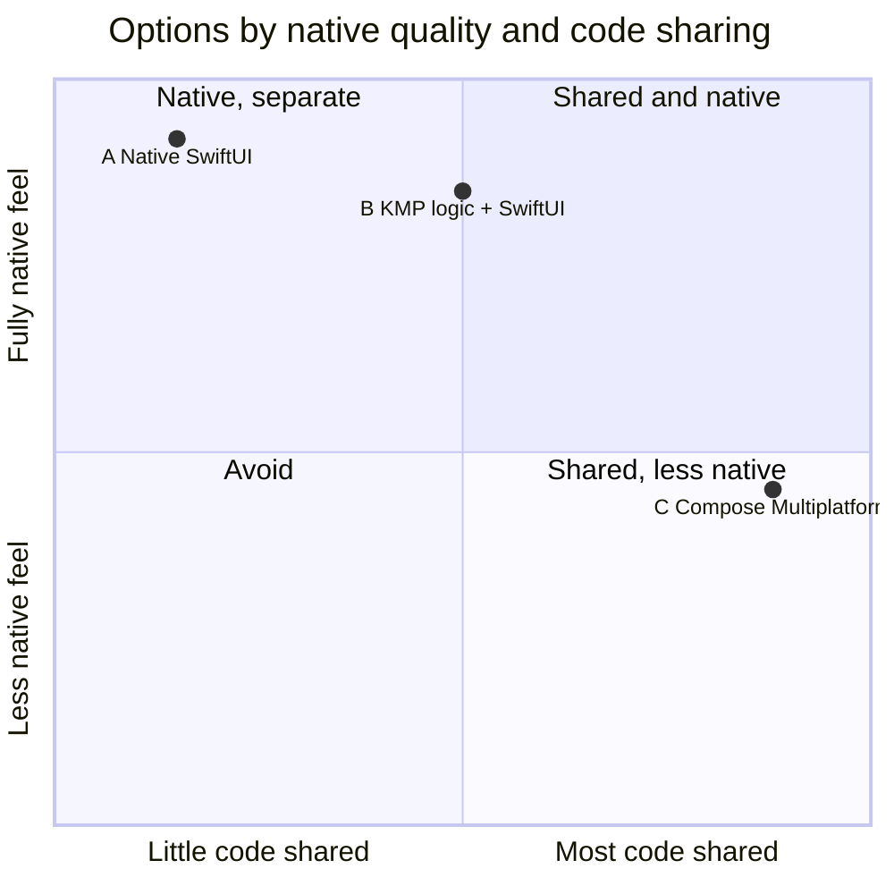

### 3.2 Recommendation: Option A, native Swift + SwiftUI

1. The owner asked for a separate iOS repository; only Option A keeps it truly independent.
2. The Android audit shows the parts that are hard to share are exactly the ones that matter most for this app: localization (`R.string`, `UiText`, `AppCompatDelegate`), dependency injection (Hilt) and asset loading. With KMP those would be rewritten anyway.
3. The shared Kotlin logic is small and stable. Rewriting it in Swift is a few days of work, and the Android unit tests become the iOS acceptance tests.
4. Children's apps live or die on accessibility, text in Kannada and a native feel. SwiftUI gives first-class VoiceOver, Dynamic Type and system fonts.
5. Drift is controlled by **sharing contracts, not code** (§10): the same mock JSON files, the same design tokens, the same translation keys, the same test case IDs.
6. The door stays open: because Domain is a pure Swift package, moving to KMP later would replace one target, not the app.

> **Owner decision D-iOS-1 (11 Nov 2026): Option A, native Swift + SwiftUI.** Everything below follows it.

---

## 4. Technology stack

All free. Versions below are the **newest stable releases on 11 Nov 2026** (checked on xcodereleases.com, Swift Package Index and GitHub release pages). They are pinned in the repository (`.xcode-version`, `Package.resolved`, `.github/workflows`), and Renovate-style update PRs (or a monthly manual check) keep them current; one major toolchain upgrade per PR.

### 4.1 Toolchain and platform

| Item | Version | Notes |
| --- | --- | --- |
| Xcode | **27.2** (27B52, 29 Oct 2026) | needs macOS 26.6 or newer on the build Mac |
| Swift | **6.4.2** (bundled with Xcode 27.2) | Swift 6 language mode, complete strict concurrency, warnings as errors in CI |
| iOS / iPadOS SDK | **27.2** | build against the newest SDK |
| Minimum deployment | **iOS 26.0 / iPadOS 26.0** | same devices as iOS 27 (iPhone 11 / SE 2nd gen and newer; iPad 8th gen, Air 3rd gen, mini 5th gen, Pro 11-inch 1st gen and newer); native Liquid Glass, current SwiftUI and SwiftData APIs without availability checks |
| Devices | iPhone and iPad, one universal target | §6A |
| CI runner | GitHub Actions `macos-26` (arm64) | its default Xcode is 26.6, so the workflow selects Xcode 27.2 explicitly (LLD §14.2) |

### 4.2 Frameworks and libraries

| Area | Choice | Version | Why |
| --- | --- | --- | --- |
| UI | SwiftUI (UIKit only where SwiftUI has no API) | SDK 27.2 | Declarative, adaptive layouts, Liquid Glass by default |
| State | Observation (`@Observable`) view models on `@MainActor`, immutable `State` structs | SDK | Fine-grained updates, no Combine |
| Async | Swift Concurrency (`async/await`, `AsyncStream`, actors), injected `Clock` | Swift 6.4 | Deterministic tests |
| Async helpers | `swift-async-algorithms` (Apple, Apache 2.0) | **1.1.7** | `combineLatest`, `debounce` |
| Navigation | `TabView` with `.sidebarAdaptable`, `NavigationSplitView` on regular width, `NavigationStack` + typed `Route` enums | SDK | Tab bar on iPhone, sidebar on iPad (§6A) |
| DI | Constructor injection + one composition root (`AppContainer`) | — | No framework needed |
| Persistence | **SwiftData** behind repository protocols | SDK | First-party, versioned schema |
| Persistence fallback | GRDB.swift (MIT), only if SwiftData blocks us (LLD §4.4) | **7.12.0** | Mature SQLite, mirrors Android Room |
| Preferences | `UserDefaults` wrapped in an actor | SDK | Same keys as Android DataStore |
| Content | Bundled JSON + `Codable` | SDK | Same files as Android |
| Localization | String Catalogs (`.xcstrings`), `LocalizedStringResource` | SDK | Plurals, completeness check |
| Fonts | Noto Sans Kannada (SIL OFL) + SF Pro | — | Kannada shaping at all sizes |
| Logging | `os.Logger` | SDK | Free, private by default |
| Unit tests | **Swift Testing** | bundled with Swift 6.4 | Parallel, parameterised |
| Test clock | `swift-clocks` (Point-Free, MIT) | **1.1.1** | `TestClock`, `ImmediateClock` |
| Snapshot tests | `swift-snapshot-testing` (Point-Free, MIT) | **1.19.7** | iPhone + iPad × EN / KN images |
| UI tests | XCUITest | Xcode 27.2 | Accessibility identifiers |
| Lint | SwiftLint (MIT) | **0.65.1** | Rule gate |
| Format | SwiftFormat (MIT) | **0.64.6** | Style gate |
| CI actions | `actions/checkout`, `actions/upload-artifact` | **v7** | Newest majors |
| Project file | Thin `.xcodeproj`; all code in the local package | — | Avoids `project.pbxproj` conflicts |

**Deliberately not used:** Firebase, Crashlytics, any analytics SDK, RevenueCat, The Composable Architecture (good, but a large learning curve for a small team; our pattern in §7 gives the same unidirectional flow with no dependency), Combine for new code, CocoaPods.

---

## 5. Architecture

### 5.1 Layers

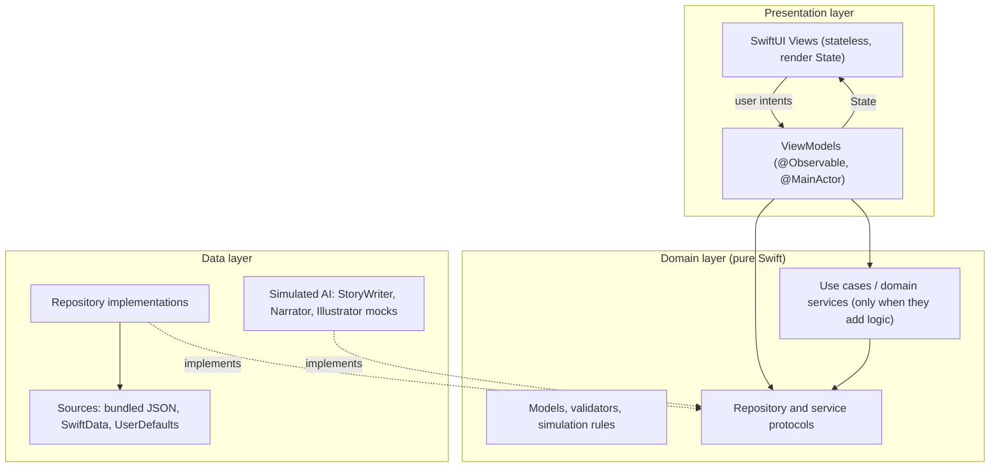

| Layer | Knows about | Never knows about |
| --- | --- | --- |
| Presentation | Domain protocols and models, design system, string catalogs | SwiftData, UserDefaults, JSON files, concrete repositories |
| Domain | Only Swift standard library and Foundation value types | SwiftUI, UIKit, SwiftData, localized text, bundles |
| Data | Domain protocols and models, storage frameworks | Views, view models, navigation |

### 5.2 SOLID, applied

| Principle | How it shows up |
| --- | --- |
| **S**ingle responsibility | A view only renders; a view model only maps intents to state; a repository only owns one kind of data; `PromptValidator` only validates |
| **O**pen/closed | A new language, story source or AI provider is a new implementation or registry entry; screens do not change |
| **L**iskov substitution | `SimulatedStoryWriter`, a future `RemoteStoryWriter` and test fakes all satisfy the same `StoryWriter` contract and its tests |
| **I**nterface segregation | Small protocols (`CatalogRepository`, `FavouritesRepository`…) instead of one big `StoryService` |
| **D**ependency inversion | View models depend on protocols in Domain; only `AppContainer` knows concrete types |

### 5.3 Modules (targets in `LittleStoryKit`)

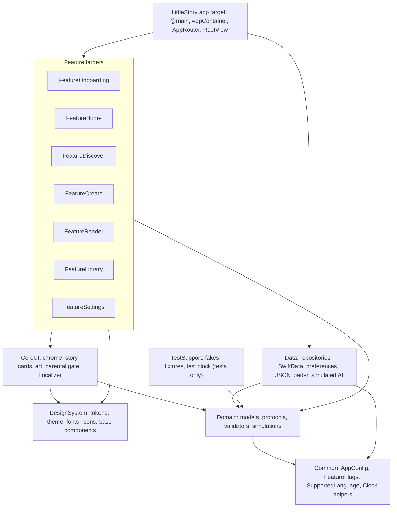

| Android module | iOS target | Notes |
| --- | --- | --- |
| `:app` | `LittleStory` app target | Composition root, root navigation, Info.plist, privacy manifest |
| `:core:common` | `Common` | Pure Swift |
| `:core:designsystem` | `DesignSystem` | Tokens generated from `design-tokens.json` |
| `:core:ui` | `CoreUI` | Includes `Localizer` (replaces `UiText` + `AppLanguage`) |
| `:domain` | `Domain` | Pure Swift; port of the Kotlin models and rules |
| `:data` | `Data` | SwiftData replaces Room, `UserDefaults` replaces DataStore |
| `:feature:*` | `Feature*` (7 targets) | Each owns its views, view models, routes and strings |
| `build-logic` dependency rules | `Tools/check-dependencies.swift` + Package.swift | CI fails on a forbidden import |

**Dependency rules (enforced in CI):**

1. Features never import other features or `Data`.
2. `Domain` imports only `Common` and Foundation (no SwiftUI, UIKit, SwiftData).
3. Only the app target imports `Data` and builds concrete objects.
4. `DesignSystem` imports nothing from the app.

---

## 6. Screens and navigation

### 6.1 Screen list (same IDs as Android)

| # | Screen | Feature | Parent only 🔒 |
| --- | --- | --- | --- |
| 01 | Onboarding | Onboarding | |
| 02 | Setup (create / edit child) | Onboarding | |
| 03 | Home | Home | |
| 04 | Discover (search, filters) | Discover | |
| 05 | Category | Discover | |
| 06 | Story Detail | Discover | |
| 07 | Create | Create | |
| 08 | Generating | Create | |
| 09 | Story Ready | Create | |
| 10 | Reader | Reader | |
| 11 | Player | Reader | |
| 12 | My Stories (All, Created, Downloaded, Favourites) | Library | |
| 13 | Downloads | Library | |
| 14 | Profile | Settings | |
| 15 | Subscription (demo) | Settings | 🔒 |
| 16 | Child profiles | Settings | 🔒 |
| 17 | Reminder | Settings | |
| 18 | Notifications | Settings | |
| 19 | Launch screen | App | |
| 20 | Language | Settings | 🔒 |
| 21 | Privacy and parent controls | Settings | 🔒 |
| 22 | Help | Settings | |

### 6.2 Navigation map

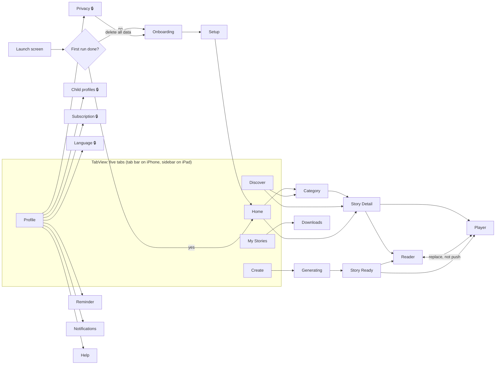

- **Root:** `RootView` shows Onboarding or the `TabView` based on the first-run flag.
- **Tabs:** each tab has its own `NavigationPath` in a `TabRouter`, so switching tabs keeps each tab's history, like Android.
- **Typed routes:** each feature declares `enum XRoute: Hashable` and a `@ViewBuilder destination(for:)`; only the app target maps routes across features.
- **Reader ↔ Player** replace the last path element instead of pushing, so Back never loops.
- **Story Ready → Back** returns to Create's root (Create and Generating are removed from the path).
- **Deep links** (later) map a URL to a `[Route]` path in one place.

---

## 6A. Devices and adaptive layout (iPhone and iPad)

The app is **one universal binary**. Layouts are chosen by the space available, never by device model, so the same rules cover iPhone portrait, iPhone landscape, iPad split screen, Slide Over and freely resized iPad windows.

### 6A.1 Supported devices and modes

| | iPhone | iPad |
| --- | --- | --- |
| Oldest supported (iOS / iPadOS 26) | iPhone 11, 11 Pro, SE (2nd gen) | iPad (8th gen), iPad Air (3rd gen), iPad mini (5th gen), iPad Pro 11-inch (1st gen) |
| Orientation | portrait and landscape | all four orientations |
| Multitasking | — | Split View, Slide Over, Stage Manager, resizable windows (iPadOS 26 windowing) |
| Input | touch, VoiceOver, Switch Control | plus hardware keyboard shortcuts, trackpad pointer, Apple Pencil taps |
| Menu bar (iPadOS 26+) | — | `commands` for Create story, Search, Settings, Next / Previous page |

### 6A.2 Layout classes

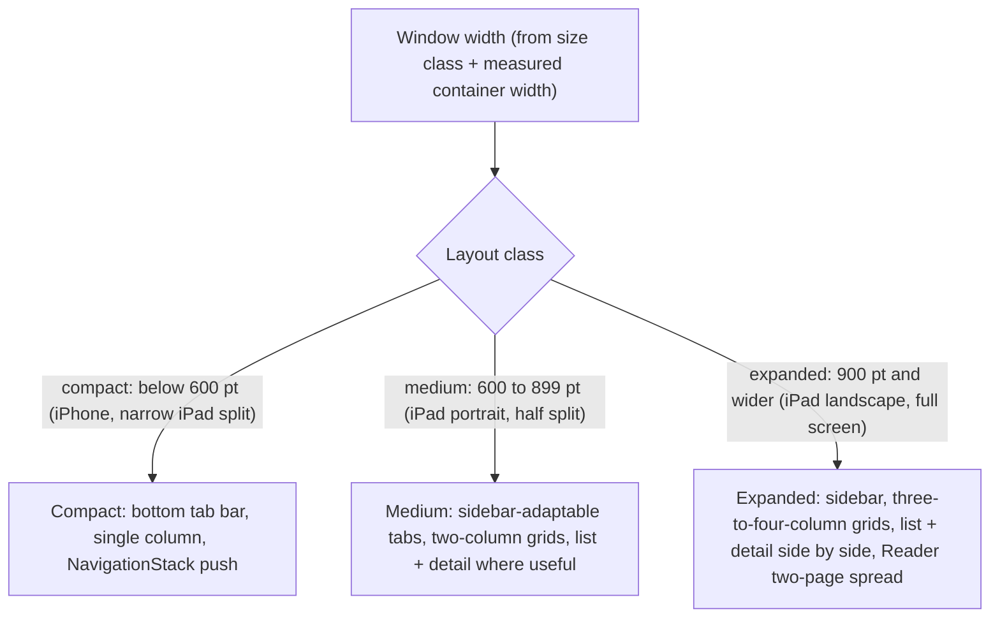

- Breakpoints are tokens (`LayoutTokens.mediumMinWidth = 600`, `expandedMinWidth = 900`) in `DesignSystem`, not literals in features.
- A screen reads one `LayoutClass` value from the environment; it is recomputed live when the window is resized or rotated.
- Content never stretches edge to edge on a wide window: readable text is capped at a token width (`readableMaxWidth`) and centred.
- Large Dynamic Type can push a screen to the compact layout even on iPad, so Kannada at AX sizes never truncates.

### 6A.3 App shell by layout class

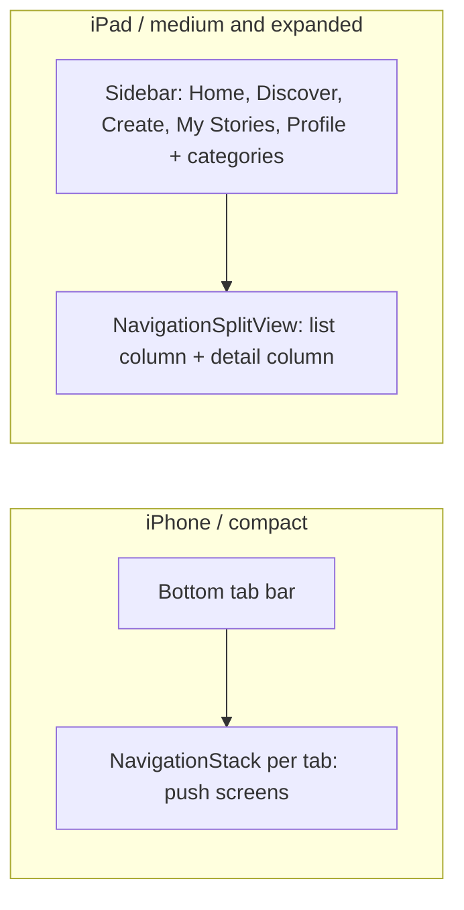

`TabView` with `.tabViewStyle(.sidebarAdaptable)` gives the iPhone tab bar and the iPad sidebar from one definition; the person can still collapse the iPad sidebar to a top tab bar.

### 6A.4 Screen-by-screen layout

| Screen | Compact (iPhone) | Medium / expanded (iPad) |
| --- | --- | --- |
| Onboarding, Setup | full-screen pages | centred card, max width token, illustration beside the form when expanded |
| Home | vertical sections, horizontal card rails | 2–4 column card grids, Resume and Featured side by side |
| Discover | search + list, push to Category / Detail | split view: categories and results in the list column, Story Detail in the detail column |
| Story Detail | full screen | detail column, or a sheet from Home |
| Create | single form | form and live preview card side by side |
| Generating, Story Ready | full screen | centred, max width |
| Reader | one page, swipe | one page in portrait; **two-page spread** in expanded landscape; text width capped |
| Player | stacked cover + controls | cover and controls side by side; chapter list visible |
| My Stories, Downloads | segmented tabs + list | grid of cards; filters in the sidebar |
| Profile and settings | grouped list, push | split view: settings list + selected setting |
| Parental gate | sheet | form sheet sized for the keypad, centred |

### 6A.5 Design deliverables this needs

The current design reference (`docs/design/screens/*.jpg`) is phone-only. To keep tablet layouts on-brand:

1. Designer (or owner) adds iPad frames for Home, Discover + Detail, Reader spread, Player and Settings split view in the Figma file, using the same tokens.
2. Until those exist, the rules in §6A.4 are the specification, and the iPad snapshot images are reviewed by the owner as the design check.
3. Token additions: layout breakpoints, grid column counts per class, readable max width, sidebar width; all in `design-tokens.json` so Android tablets can use the same values later.

### 6A.6 Liquid Glass (iOS 26 design)

- System bars, tab bar, sidebar, sheets and toolbars use the system Liquid Glass material automatically; we do not re-skin them.
- Brand colour and illustrations stay in content; glass is used only for floating controls (Player controls, Reader toolbar) through the design system, never directly in features.
- Respect Reduce Transparency and Increase Contrast settings: the design system swaps glass for solid token colours.

---

## 7. Presentation pattern (unidirectional data flow)

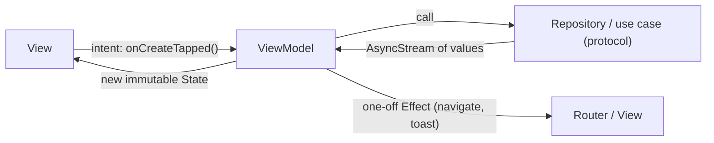

1. Each screen has **one immutable `State` struct** owned by an `@Observable @MainActor` view model.
2. The view calls **one method per user action** (`onNext()`, `onToggleFavourite()`), matching the Android pattern.
3. View models **observe repositories as `AsyncSequence`s** in a `.task` tied to the view's lifetime, so work stops when the screen goes away (the iOS equivalent of `collectAsStateWithLifecycle`).
4. **One-off effects** (navigate after generation, data deleted) are delivered through an `AsyncStream<Effect>` or a callback closure to the router; they are never stored in `State`.
5. **Views are split** into `XScreen` (takes `State` + `Actions`, no view model, used by previews and snapshots) and `XRoute` (creates the view model and wires navigation).
6. View models **never hold display strings**; they hold `LocalizedStringResource` values or enums, resolved by the view.

---

## 8. Data and persistence

| Store | Technology | Contents | Child data? |
| --- | --- | --- | --- |
| Mock content | JSON in the `Data` target's resources, decoded with `Codable` | `stories_{en,kn}`, `categories_{en,kn}`, `generated_{en,kn}`, `notifications_{en,kn}`, `plans` (identical files to Android) | No |
| `LittleStory.store` | SwiftData, versioned schema | child profiles, saved stories, reading progress, downloads, generated stories, notification read state | First name, age, avatar, interests only |
| Preferences | `UserDefaults` (app suite) | first-run flag, content language, active child id, text scale, playback speed, reminder, notification and download settings | No |
| UI language | iOS per-app language (`AppleLanguages`) or in-app override (§9) | language tag | No |

- **Single source of truth:** the store emits, every observing screen updates; view models never keep a second copy of persisted state.
- **English is the base** for all content; a translation file overrides text field by field, so a missing Kannada field shows English instead of failing.
- **Delete all data** wipes the SwiftData store and preferences and returns to Onboarding.
- **File protection:** the store uses `NSFileProtectionComplete` (`.completeUntilFirstUserAuthentication` for background-safe access) and is excluded from iCloud backup until accounts and consent exist.

---

## 9. Localization

| Topic | Rule |
| --- | --- |
| Languages | `SupportedLanguage` registry in `Common`: `en` (default, fallback), `kn`. Native names shown in pickers: English, ಕನ್ನಡ |
| UI strings | One `Localizable.xcstrings` per target that owns UI; no literal user-facing text in Swift |
| View model text | `LocalizedStringResource` or enums mapped to resources (the iOS `UiText`) |
| Plurals and arguments | String Catalog plural variants and positional `%1$@` / `%2$lld`; never concatenate sentences |
| Two languages, two settings | **UI language** (menus, buttons) and **story language** (content) are separate, like Android |
| Switching UI language | Primary: an in-app `Localizer` override that reloads strings at once without restarting. Also supported: the system per-app language page in iOS Settings, opened from the Language screen |
| Content | Repositories take a `languageTag` and resolve with English fallback |
| Layout | Leading/trailing only, no fixed text heights, multi-line everywhere, tested at the largest accessibility size with Kannada |
| Numbers and dates | `FormatStyle` with the active locale |
| Fonts | Bundled Noto Sans Kannada with taller line height for Kannada |
| Gates | CI fails if any key lacks a Kannada value or is marked "needs review" without a workbook entry; new Kannada text is a draft until a native speaker approves it |

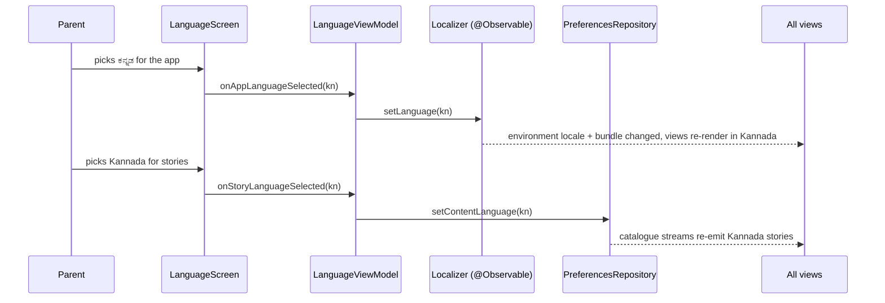

> **Spike LS-iOS-S1:** prove the in-app override in a throwaway branch (String Catalog lookup with an explicit locale and bundle across all targets, plus `\.locale` for formatting). If any piece cannot follow the override, fall back to the system per-app language page only.

---

## 10. Keeping iOS and Android in step (shared contracts)

| Contract | Source of truth | How iOS uses it |
| --- | --- | --- |
| Mock content JSON | Android `data/src/main/assets/mock/` | Copied into `Data/Resources/Mock/` by `Tools/sync-android-content.sh`; same decoder tests on both sides |
| Design tokens | `docs/design/design-tokens.json` | `Tools/gen-tokens` generates `DesignSystem/Tokens.generated.swift` |
| Translations | Android `strings.xml` (EN, KN) and the workbook Translations sheet | `Tools/import-android-strings` converts to `.xcstrings`, keeping the same keys |
| Screens and states | `docs/design/screen-inventory.md`, `screen-state-matrix.md` | Same screen IDs, same states, same acceptance criteria |
| Test cases | Workbook test cases (TC-###) | iOS tests reference the same IDs |
| Backlog | Jira workbook | iOS tickets use the `LS-iOS-###` prefix |

---

## 11. Simulated (mocked) AI features

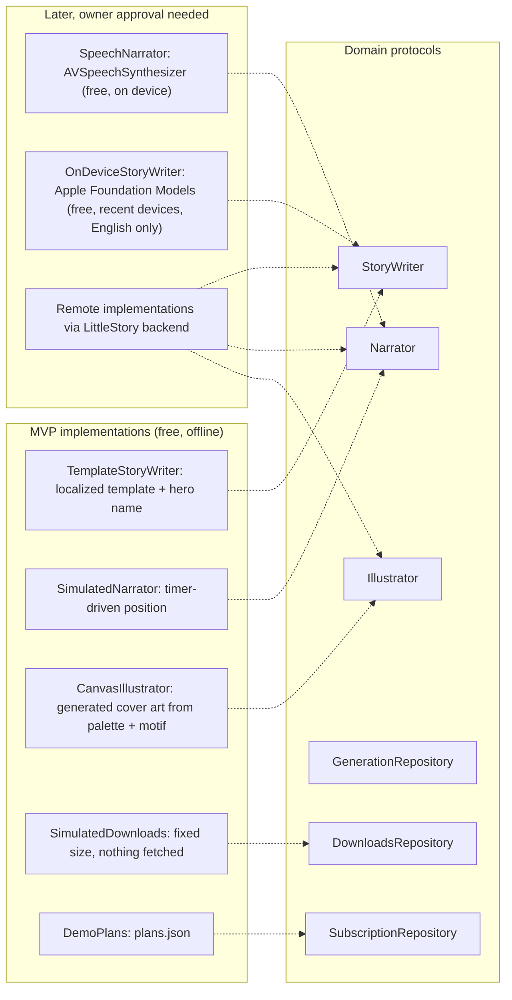

| Feature | MVP simulation | UI label | Swap point |
| --- | --- | --- | --- |
| Story generation | Progress +4 % every 120 ms in three stages, then the localized template filled with the hero's first name and saved | "Demo story" badge | `StoryWriter` |
| Narration | Position advanced on a 500 ms tick; chapters = pages; speed, skip 15 s, sleep timer | "Narration preview, no sound yet" | `Narrator` |
| Pictures | Generated cover art from the story's palette and motif (SwiftUI `Canvas`) | none (art is by design) | `Illustrator` |
| Downloads | A saved record with a fixed size | "Simulated download" | `DownloadsRepository` |
| Subscription | Illustrative plans, no purchase | "Demo plans" | `SubscriptionRepository` |
| Notifications | Mock inbox per language, nothing scheduled | — | `NotificationsRepository` |

- All simulations take an injected `Clock`, so tests run them instantly.
- Selection happens in one place: `AppContainer` reads `FeatureFlags` and picks the implementation.
- The prompt the parent types is never stored, matching Android.

---

## 12. Cross-cutting concerns

| Concern | Approach |
| --- | --- |
| Configuration | `AppConfig` (limits, options, timings) and `FeatureFlags` in `Common`; build settings in `.xcconfig` per configuration (Debug, Release); no secrets anywhere |
| Design system | Tokens for colour, type, spacing, radius, elevation, motion; components (`LSButton`, `LSChip`, `LSTextField`, banners, toasts); one light theme with night surfaces for bedtime screens |
| Accessibility | 44 pt minimum targets (Apple HIG), VoiceOver labels and hints from string catalogs, `accessibilityValue` for progress, Dynamic Type up to AX5, Reduce Motion respected, contrast AA |
| Errors | No error reaches the user as a crash or raw text: missing content becomes a Not Found state, bad JSON falls back to English, an unknown generation request becomes a paused state |
| Logging | `os.Logger` per subsystem; no child names or prompts in logs |
| Security | No network entitlement needed beyond default, ATS left on, no third-party SDKs, data protection on files, no secrets in the repo (public) |
| Privacy | `PrivacyInfo.xcprivacy` declares no tracking, no collected data, and the required-reason API for `UserDefaults` (CA92.1) |
| Kids category readiness | Parental gate before links out, purchases and settings (App Store Review Guidelines 1.3 and 5.1.4); no ads, no analytics |
| Performance | Lazy stacks for lists, JSON parsed once per language and cached in an actor, images drawn not decoded, launch < 1 s on the oldest supported devices (iPhone 11, iPad 8th gen) |

### Cost and tooling notes (no paid services)

| Need | Free path | Paid only if… |
| --- | --- | --- |
| Build and run in Simulator | Xcode on any Mac | — |
| Run on your own iPhone | Free Apple ID "personal team" signing; the app expires after 7 days and must be re-installed | — |
| CI | GitHub Actions macOS runners are free for public repos | the repo is private (minutes are charged at a 10× rate after the free quota) |
| TestFlight, App Store | — | **Apple Developer Program, US$99 / year**; owner decision at release time |
| AI and voices | Mocks; optional on-device AVSpeechSynthesizer | real AI or premium voices |

> **Important:** iOS apps can only be built with Xcode on macOS. The cloud agent workspace is Linux, so iOS build and test evidence must come from GitHub Actions macOS runners or the owner's Mac.

---

## 13. Repository, branching and CI

### 13.1 Repository layout

```text
LittleStory-iOS/
├── LittleStory.xcodeproj          # thin app project
├── App/                           # @main, AppContainer, AppRouter, RootView, Info.plist, PrivacyInfo.xcprivacy, Assets
├── Config/                        # Debug.xcconfig, Release.xcconfig, Shared.xcconfig
├── Packages/LittleStoryKit/       # Package.swift + Sources/<Target>/ + Tests/<Target>Tests/
├── Tools/                         # check-dependencies, check-hardcoding, check-translations, gen-tokens, sync scripts
├── docs/                          # HLD, LLD, ADRs, localization, testing
├── .github/workflows/ci.yml
├── .swiftlint.yml, .swiftformat, .xcode-version, .gitattributes, .gitignore
└── CLAUDE.md, .github/copilot-instructions.md
```

### 13.2 Branching (same model as Android)

`development` (default, PR target) → `staging` → `main`; `feature/LS-iOS-###-slug`, `fix/…`, `docs/…`, `chore/…`; only the owner merges promotions and releases.

### 13.3 CI pipeline

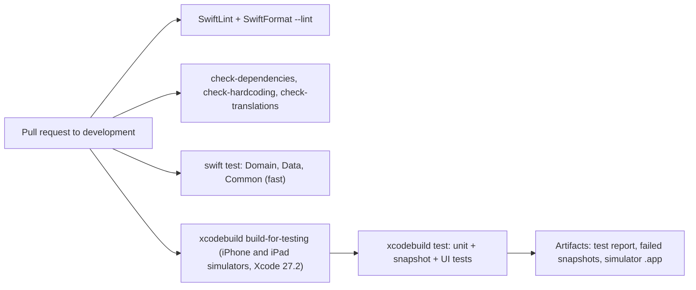

---

## 14. Testing strategy

| Level | Tool | What | Target share |
| --- | --- | --- | --- |
| Pure unit | Swift Testing | validators, simulations, config, content resolver | 50 % |
| Repository | Swift Testing + in-memory SwiftData | catalogue merge, persistence, favourites ordering | 15 % |
| View model | Swift Testing + fakes + test clock | every screen's state transitions and effects | 20 % |
| Snapshot | swift-snapshot-testing | each screen × iPhone + iPad (portrait, landscape) × EN / KN, plus KN at AX5 | 10 % |
| UI journey | XCUITest | first run, create story, read, listen, switch language, delete data | 5 % |

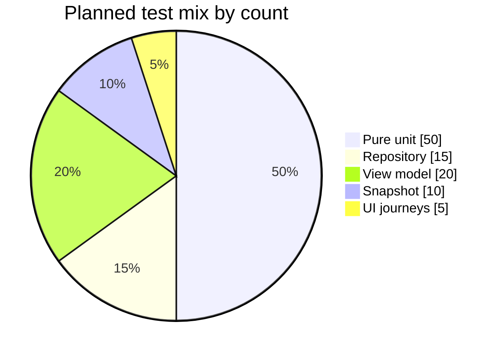

- Coverage gate: ≥ 80 % lines on Domain and view models (`xccov` report in CI).
- UI tests find elements by accessibility identifier, never by English text.
- Snapshot baselines are approved by the owner, never auto-approved.

---

## 15. Delivery plan

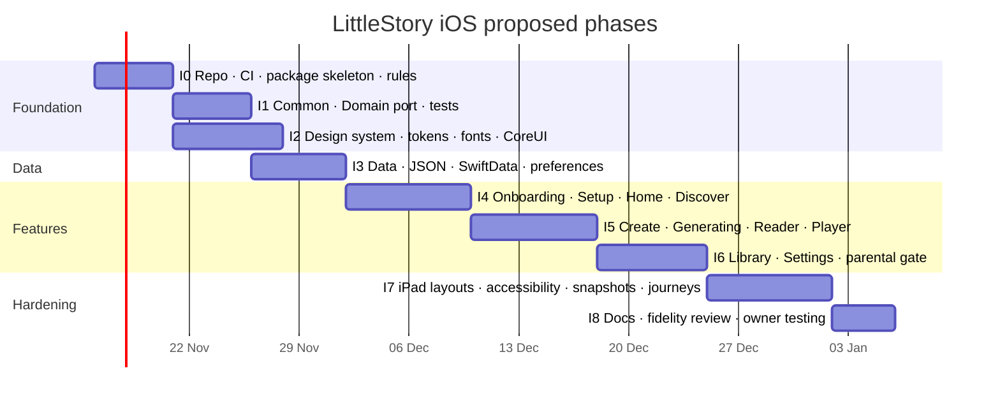

| Phase | Exit criteria |
| --- | --- |
| I0 | Empty app builds in CI; dependency, lint and translation gates run |
| I1 | Domain port passes tests mirroring Android `:domain` tests |
| I2 | Token-driven components with snapshots in EN / KN |
| I3 | Repositories pass the same scenarios as Android `:data` tests |
| I4–I6 | Each screen matches its design reference and state matrix on iPhone, and has a working compact and regular layout, with tests |
| I7 | iPad split view, sidebar, Reader spread and resized windows reviewed; AX5 Dynamic Type and VoiceOver pass on every screen; journeys green on iPhone and iPad |
| I8 | Owner tests on iPhone and iPad (Simulator or own devices); owner decides on Developer Program |

---

## 16. Risks and open questions

| # | Risk or question | Mitigation / owner action |
| --- | --- | --- |
| R1 | In-app language switch without restart is not a standard iOS API | Spike S1 (§9); fallback to the system per-app language page |
| R2 | Kannada text overflows at large Dynamic Type | Multi-line layouts, snapshot at AX5 in Kannada as a gate |
| R3 | SwiftData maturity (migrations, concurrency) | Hidden behind repository protocols; GRDB fallback (LLD §4.4) |
| R4 | Android and iOS drift | Shared contracts and sync tools (§10); same test IDs |
| R5 | No Mac in the cloud workspace | All evidence from CI macOS runners or the owner's Mac |
| R6 | Store release needs a paid Apple account | Owner decision at release (Level F); not needed for development |
| R7 | No iPad designs exist yet | §6A rules are the spec; owner reviews iPad snapshots; iPad frames added to Figma when possible |
| R8 | GitHub's `macos-26` runner defaults to Xcode 26.6 | Workflow selects Xcode 27.2; if the image lacks it, use the `xcode-27` runner label until it is added |
| Q1 | ~~Confirm native SwiftUI (D-iOS-1)~~ | Decided 11 Nov 2026: native Swift + SwiftUI |
| Q2 | Repository name and visibility (public keeps CI free) | Owner; proposed `LittleStory-iOS`, public |
| Q3 | Minimum iOS 26 acceptable? | Owner; iOS 26 and 27 run on the same devices, so iOS 26 reaches everyone who can run the latest OS while keeping the newest APIs |
| Q4 | ~~iPad scope~~ | Decided 11 Nov 2026: iPhone and iPad, adaptive layouts from the start (§6A) |
| Q5 | Bundle identifier, e.g. `com.littlestory.app` | Owner |
