# LittleStory iOS — Low-level design

**Status:** Draft v0.2 for owner review · 11 Nov 2026 (v0.2: iPad adaptive layout §9.4, exact latest versions, minimum iOS 26)
**Companion:** [High-level design](high-level-design.md). Read the HLD first; this document assumes its decisions (native Swift 6.4 + SwiftUI, Xcode 27.2, iPhone + iPad universal app, minimum iOS 26, one local package, no paid services, mocked AI).
**Reference:** Android LLD (`development` @ `5c505c6`). Section numbers in brackets, such as [A-4.3], point to the matching Android LLD section.

---

## Contents

1. Package and targets
2. `Common`
3. `Domain`
4. `Data`
5. Presentation pattern
6. Navigation
7. Dependency injection and app start
8. Localization
9. Design system, `CoreUI` and adaptive layout (iPhone and iPad)
10. Key flows
11. Error handling
12. Screen catalogue
13. Testing
14. Tooling and CI
15. Coding conventions
16. Extension recipes

---

## 1. Package and targets

> **As built in phase I0:** the data target is named `DataLayer` (a module called `Data` would clash with `Foundation.Data`); the app project is generated from `project.yml` by XcodeGen; the checks in `Tools/` are Python scripts so they also run on Linux.

### 1.1 Folder layout

```text
Packages/LittleStoryKit/
├── Package.swift
├── Sources/
│   ├── Common/            AppConfig.swift, FeatureFlags.swift, SupportedLanguage.swift, AppInfo.swift, ParentalGate.swift
│   ├── Domain/            Models/, Validation/, Repositories/, Services/, Simulation/
│   ├── Data/              Content/, Persistence/, Preferences/, Repositories/, Simulated/, Resources/Mock/*.json
│   ├── DesignSystem/      Palette, LSColor, LSTypography, LSFonts, Dimens, LSIcon, LSButtons, Resources/{Fonts,Icons.xcassets,Licenses}
│   ├── CoreUI/            Chrome/, Story/, Illustration/, Localization/, Safety/, Loading/
│   ├── FeatureOnboarding/ Onboarding/, Setup/, OnboardingRoute.swift, Localizable.xcstrings
│   ├── FeatureHome/ …     (same shape for Discover, Create, Reader, Library, Settings)
│   └── TestSupport/       Fakes/, Fixtures/ (clocks come from swift-clocks)
└── Tests/
    ├── CommonTests/  DomainTests/  DataTests/  CoreUITests/
    └── Feature*Tests/     ViewModel tests + snapshot tests (__Snapshots__/)
```

### 1.2 `Package.swift` (shape)

```swift
// swift-tools-version: 6.4
import PackageDescription

let package = Package(
    name: "LittleStoryKit",
    defaultLocalization: "en",
    platforms: [.iOS(.v26)],
    products: [ .library(name: "LittleStoryKit", targets: ["AppFeatures", "Data"]) ],
    dependencies: [
        .package(url: "https://github.com/apple/swift-async-algorithms", exact: "1.1.7"),
        .package(url: "https://github.com/pointfreeco/swift-clocks", exact: "1.1.1"),
        .package(url: "https://github.com/pointfreeco/swift-snapshot-testing", exact: "1.19.7"),
    ],
    targets: [
        .target(name: "Common"),
        .target(name: "Domain", dependencies: ["Common",
                 .product(name: "AsyncAlgorithms", package: "swift-async-algorithms")]),
        .target(name: "Data", dependencies: ["Domain", "Common"], resources: [.process("Resources")]),
        .target(name: "DesignSystem", resources: [.process("Fonts"), .process("Icons")]),
        .target(name: "CoreUI", dependencies: ["DesignSystem", "Domain"], resources: [.process("Localizable.xcstrings")]),
        .target(name: "FeatureHome", dependencies: ["CoreUI", "DesignSystem", "Domain"]),
        // … one target per feature, identical dependency list
        .target(name: "AppFeatures", dependencies: ["FeatureOnboarding", "FeatureHome", "FeatureDiscover",
                 "FeatureCreate", "FeatureReader", "FeatureLibrary", "FeatureSettings"]),
        .target(name: "TestSupport", dependencies: ["Domain"]),
        .testTarget(name: "DomainTests", dependencies: ["Domain", "TestSupport",
                 .product(name: "Clocks", package: "swift-clocks")]),
        .testTarget(name: "FeatureHomeTests", dependencies: ["FeatureHome", "TestSupport",
                 .product(name: "SnapshotTesting", package: "swift-snapshot-testing")]),
    ],
    swiftLanguageModes: [.v6]
)
```

- Versions are the newest stable on 11 Nov 2026 and pinned with `exact:` plus `Package.resolved`; upgrades come as one-dependency PRs.
- Every target turns on `StrictConcurrency` (default in Swift 6 mode) and `-warnings-as-errors` in CI.

### 1.3 Allowed imports (checked by `Tools/check-dependencies`)

| Target | May import |
| --- | --- |
| `Common` | Foundation |
| `Domain` | `Common`, Foundation, AsyncAlgorithms |
| `Data` | `Domain`, `Common`, Foundation, SwiftData, OSLog |
| `DesignSystem` | SwiftUI |
| `CoreUI` | `DesignSystem`, `Domain`, `Common`, SwiftUI |
| `Feature*` | `CoreUI`, `DesignSystem`, `Domain`, `Common`, SwiftUI |
| App target | everything |

The script parses `import` lines per source folder and fails CI on any edge not in this table (the iOS twin of Android `DependencyRules.kt`).

---

## 2. `Common` [A-2]

| Type | Kind | Holds |
| --- | --- | --- |
| `AppConfig` | `enum` namespaces of `static let` | all limits, options and timings (below) |
| `FeatureFlags` | `struct`, `Sendable` | `demoSubscription`, `draftLegalText`, `onDeviceNarration`, `accounts` (all default off except demo) |
| `SupportedLanguage` | `struct` + registry | `tag`, `nativeName`, `isEnabled`, `isRightToLeft` |
| `AppInfo` | `struct` | version, build, from `Bundle.main` (injected) |
| `ParentalGateChallenge` | `struct` | `a × b`, `isAnswered(by:)`; `ParentalGateChallenges` protocol with random and fixed versions |

```swift
public enum AppConfig {
    public enum Create {
        public static let promptMaxCharacters = 500
        public static let durationOptionsMinutes = [5, 8, 10, 15]
        public static let defaultDurationMinutes = 8
        public static let themes = ["adventure", "bedtime", "animals", "friendship", "fantasy", "learning", "indian_folklore"]
        public static let moods = ["calm", "funny", "magical", "adventurous"]
    }
    public enum Profile {
        public static let nameMaxCharacters = 30
        public static let ageRange = 3...12
        public static let defaultAge = 6
        public static let durationOptionsMinutes = [5, 10, 15]   // differs from Create, as on Android (open question C1)
        public static let interestIDs = ["animals", "cricket", "adventure", "space", "nature", "music"]
        public static let guestKey = "guest"
    }
    public enum Generation {
        public static let stepPercent = 4
        public static let stepInterval: Duration = .milliseconds(120)
        public static let restartPercent = 8
        public static let stageThresholdsPercent = (imagining: 38, writing: 76)
        public static let readyDelay: Duration = .milliseconds(500)
    }
    public enum Playback {
        public static let tick: Duration = .milliseconds(500)
        public static let tickFraction = 0.0025
        public static let skipSeconds = 15
        public static let speeds: [Double] = [0.75, 1.0, 1.25, 1.5]
        public static let saveEveryTicks = 10
        public static let sleepTimerMinutes = [10, 15, 30]
    }
    public enum Reader { public static let textScaleRange = 0.9...1.3; public static let textScaleStep = 0.1 }
    public enum Downloads { public static let simulatedStoryBytes: Int64 = 12_000_000; public static let simulatedQuotaBytes: Int64 = 1_000_000_000 }
    public enum UI { public static let loadingIndicatorDelay: Duration = .milliseconds(300) }
}

public struct SupportedLanguage: Sendable, Hashable, Identifiable {
    public let tag: String          // BCP-47: "en", "kn"
    public let nativeName: String   // the language's own name; not translated by design
    public let isEnabled: Bool
    public var id: String { tag }

    public static let english = SupportedLanguage(tag: "en", nativeName: "English", isEnabled: true)
    public static let kannada = SupportedLanguage(tag: "kn", nativeName: "ಕನ್ನಡ", isEnabled: true)
    public static let all: [SupportedLanguage] = [.english, .kannada]
    public static let fallback = english
    public static var enabled: [SupportedLanguage] { all.filter(\.isEnabled) }
}
```

Values copy the Android `AppConfig` (`core/common/.../config/AppConfig.kt` on `development`) so both apps behave the same; the snippet shows a subset, the full list is ported in ticket LS-iOS-010. The Android debug-only Gemini prototype adds `writerWaitPercent = 92` and `writerTimeout = 90 s` for a real writer; iOS keeps the same two values ready for a future `StoryWriter`.

---

## 3. `Domain` [A-4]

Pure Swift. Every type is a `struct` or `enum`, `Sendable`, `Hashable` where useful. No localized text: content strings (story titles) arrive already resolved for a language; UI copy lives in feature string catalogs.

### 3.1 Models

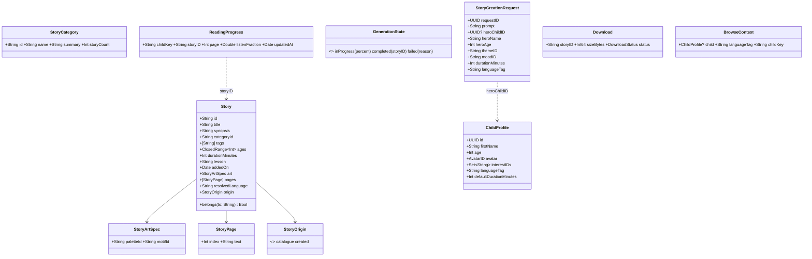

Other models (same meaning as Android): `SavedStory`, `PlaybackState`, `SleepTimer` (`.off`, `.minutes(Int)`, `.endOfStory`), `ReadingPreferences(textScale, playbackSpeed)`, `ReminderSettings(enabled, time, weekdays)`, `ParentSettings`, `NotificationItem` (+ `section`, `kind`), `Plan` (price in minor units + ISO currency), `ChildProfileDraft`.

- `childKey` is the child's id, or the constant guest key when no profile exists (Skip in Setup).
- `Story` is a value type; a created story uses id `generated_<requestID>` so a retry never duplicates.

### 3.2 Validation [A-4.2]

| Validator | Input | Errors |
| --- | --- | --- |
| `PromptValidator.validate(_:)` | prompt | `.empty` (blank after trimming), `.tooLong` (> 500) |
| `ProfileValidator.validate(_:)` | `ChildProfileDraft` | `Set<ProfileError>`: `.nameEmpty`, `.nameTooLong` (> 30), `.ageOutOfRange` (not 3…12), `.durationNotAllowed` |

Validators are pure `static func`s returning `Result` or a `Set`, so they are trivially unit tested.

### 3.3 Repository and service protocols [A-4.3]

Reads are `AsyncStream`s that emit the current value at once and again on every change. Writes are `async`. All protocols are `Sendable`.

| Protocol | Reads | Writes |
| --- | --- | --- |
| `CatalogRepository` | `categories(language:)`, `stories(language:)`, `story(id:language:)` | — |
| `ProfilesRepository` | `profiles()`, `activeProfile()` | `create(_:)`, `update(_:)`, `delete(id:)`, `setActive(id:)` |
| `FavouritesRepository` | `favouriteIDs(childKey:)` | `setFavourite(_:storyID:childKey:)`, `toggle(storyID:childKey:) -> Bool` |
| `LibraryRepository` | `created(childKey:)`, `story(id:)` | `save(_:childKey:)` |
| `GenerationRepository` | `request(id:)`, `generate(id:startPercent:) -> AsyncStream<GenerationState>` | `submit(_:)` |
| `ProgressRepository` | `progress(childKey:)` | `update(_:)` |
| `DownloadsRepository` | `downloads()` | `start(storyID:)`, `remove(storyID:)` |
| `PreferencesRepository` | `firstRunCompleted()`, `contentLanguage()`, `reading()`, `parentSettings()` | setters |
| `NotificationsRepository` | `notifications(language:)` | `markRead(id:)`, `markAllRead()` |
| `SubscriptionRepository` | `plans()` | — |
| `LocalDataRepository` | — | `deleteAll()` |
| **AI services** | | |
| `StoryWriter` | — | `write(_ request: StoryCreationRequest) async throws -> StoryDraft` |
| `Narrator` | `events() -> AsyncStream<NarrationEvent>` | `load(_:)`, `play()`, `pause()`, `seek(to:)`, `setRate(_:)` |
| `Illustrator` | — | `art(for: StoryDraft) async -> StoryArtSpec` |

```swift
public protocol CatalogRepository: Sendable {
    func categories(language: String) -> AsyncStream<[StoryCategory]>
    func stories(language: String) -> AsyncStream<[Story]>
    func story(id: String, language: String) -> AsyncStream<Story?>
}

public protocol StoryWriter: Sendable {
    /// MVP: TemplateStoryWriter. Later: on-device or remote writers. Must never log the prompt.
    func write(_ request: StoryCreationRequest) async throws(StoryWriterError) -> StoryDraft
}
```

`StoryStores` bundles catalogue, library, favourites, downloads and progress for Reader, Player and My Stories, exactly as on Android.

### 3.4 Domain services (instead of thin use cases)

Only logic that is shared and non-trivial becomes a type; there is no use case that only forwards a call.

| Service | Job |
| --- | --- |
| `BrowseContextProvider` | combines `activeProfile()` and `contentLanguage()` into `AsyncStream<BrowseContext>` |
| `StoryLookup` | catalogue story, else created story, for a context (`observeStory` on Android) |
| `SearchStories` | locale-aware, diacritic-insensitive search over title, synopsis and category name |
| `GenerationEngine` | runs `GenerationProgress` then calls `StoryWriter` and `LibraryRepository.save` |

### 3.5 Simulation rules [A-4.4]

**Generation progress** — `GenerationProgress.run(from:clock:)` yields `.inProgress(p)` immediately, then `+4` every 120 ms on the injected clock until 100. Cancelling the consuming task pauses it.

```swift
public struct GenerationProgress: Sendable {
    let clock: any Clock<Duration>
    public func run(from start: Int) -> AsyncStream<Int> {
        AsyncStream { continuation in
            let task = Task {
                var percent = start
                continuation.yield(percent)
                while percent < 100, !Task.isCancelled {
                    try? await clock.sleep(for: AppConfig.Generation.stepInterval)
                    percent = min(percent + AppConfig.Generation.stepPercent, 100)
                    continuation.yield(percent)
                }
                continuation.finish()
            }
            continuation.onTermination = { _ in task.cancel() }
        }
    }
    public static func stage(for percent: Int) -> GenerationStage { /* imagining < 38 ≤ writing < 76 ≤ preparingNarration */ }
}
```

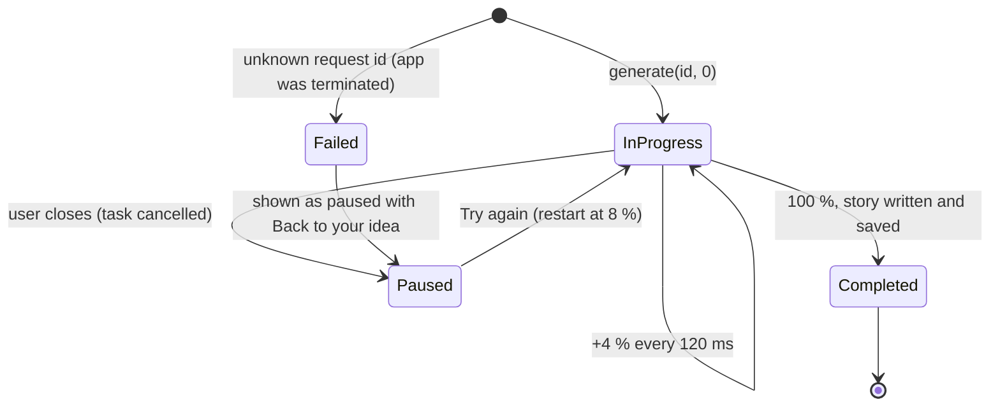

**Playback** — `SimulatedPlayback` pure functions on a position fraction 0…1:

| Function | Rule |
| --- | --- |
| `totalSeconds(minutes:)` | `max(minutes, 1) × 60` |
| `tick(_:speed:)` | `+ 0.0025 × speed`, clamped to 1 |
| `skip(_:minutes:direction:)` | `± 15 / totalSeconds` |
| `chapter(of:pageCount:)`, `chapterStart(_:pageCount:)` | pages spread evenly |
| `nextSpeed(after:)` | cycles 0.75 → 1.0 → 1.25 → 1.5 |
| `sleepAfterSeconds(_:)` | `.minutes(n)` → `n × 60`, else `nil` |

---

## 4. `Data` [A-5]

### 4.1 Content loading and the English fallback

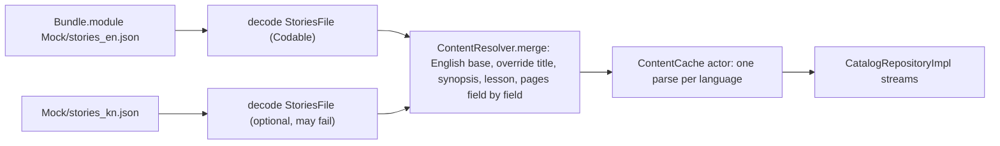

- `MockContentSource` protocol: `func data(named: String) -> Data?`. The app reads `Bundle.module`; tests read fixtures.
- Decoding uses `JSONDecoder` with lenient structs (unknown keys ignored by default in `Codable`; optional fields for anything a translation may omit).
- A blank or missing translated field keeps English; `resolvedLanguage` is the target language only when the title was translated.
- `ContentCache` is an `actor` holding `[String: ResolvedCatalogue]`; concurrent first reads await one parse task.

### 4.2 SwiftData schema

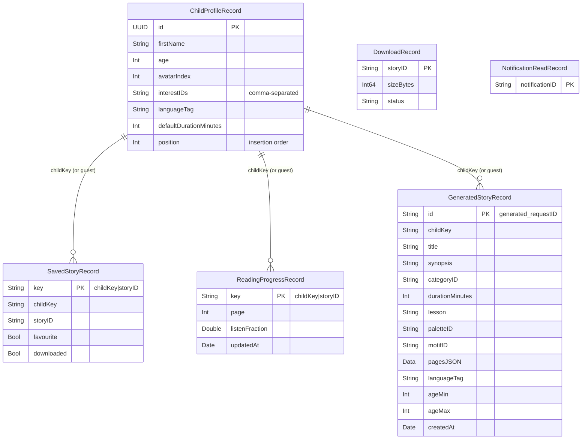

- `@Model` classes use `@Attribute(.unique)` on the key; composite keys are a joined string because SwiftData has no composite primary key.
- No relationships, like Android: the guest key has no profile row. `ProfilesRepositoryImpl.delete` removes that child's rows explicitly in one transaction.
- Schema is versioned from day one: `LittleStorySchemaV1: VersionedSchema` and `LittleStoryMigrationPlan: SchemaMigrationPlan`.
- `@Model` objects never leave the Data layer: each record maps to a Domain struct (`record.toDomain()`, `Record(domain)`), because model objects are not `Sendable`.

### 4.3 Store access and change streams

SwiftData only auto-observes through `@Query` inside views, which would leak storage into the UI. So the Data layer provides its own observation:

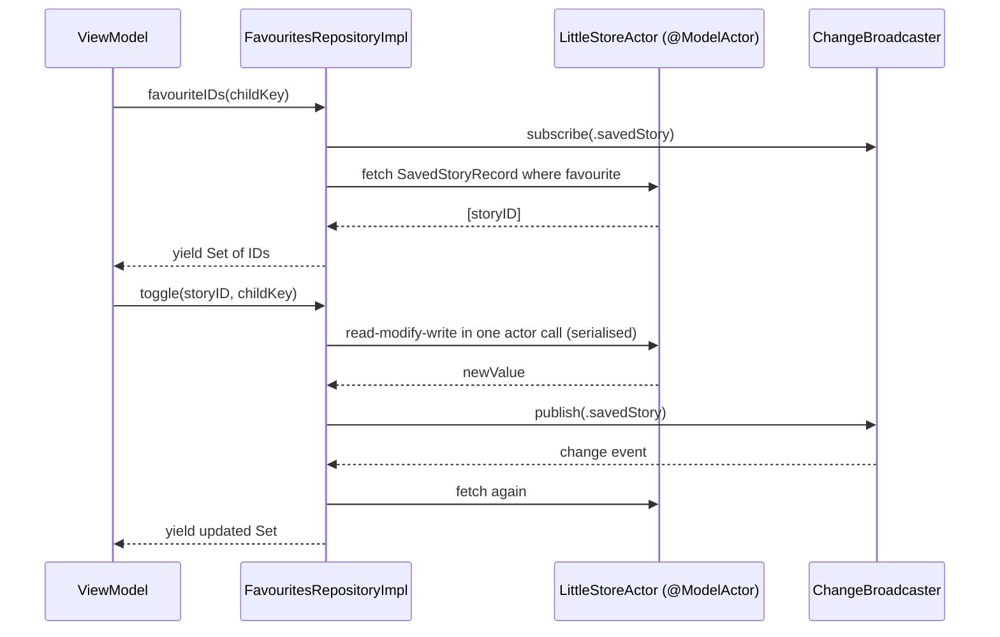

- `LittleStoreActor` is a `@ModelActor`, so all reads and writes are serialised off the main thread; this replaces the Android `Mutex` on favourites.
- `ChangeBroadcaster` is an `actor` that fans out `AsyncStream<Table>` events to subscribers; each repository re-queries only for its table.

### 4.4 Fallback: GRDB

If SwiftData blocks us (migration bug, performance, concurrency warnings), swap the store for **GRDB.swift** (MIT): SQL schema mirroring Android Room, `DatabaseMigrator`, and `ValueObservation` for streams. Only `Data/Persistence/` changes; repository protocols and tests stay. Decision record: ADR-iOS-004.

### 4.5 Preferences

`PreferencesStore` is an `actor` over `UserDefaults(suiteName:)` that also broadcasts changes. Keys match the Android DataStore keys.

| Key | Type | Default |
| --- | --- | --- |
| `first_run_completed` | Bool | false |
| `content_language_tag` | String | `en` |
| `ui_language_tag` | String? | nil (follow system) |
| `active_profile_id` | String? | nil |
| `reader_text_scale` | Double | 1.0 |
| `playback_speed` | Double | 1.0 |
| `reminder_enabled`, `reminder_hour`, `reminder_minute`, `reminder_days` | Bool, Int, Int, [String] | false, 20, 30, all days |
| `notifications_enabled`, `wifi_only_downloads` | Bool | true, true |

### 4.6 Repository implementations

| Implementation | Backing | Key behaviour |
| --- | --- | --- |
| `CatalogRepositoryImpl` | `MockContentSource` + `ContentCache` | §4.1; `storyCount` computed from `belongs(to:)` |
| `GenerationRepositoryImpl` | in-memory `[UUID: StoryCreationRequest]` in an actor + `GenerationEngine` | `generate` emits progress, then writes and saves the story, then `.completed`; unknown id → `.failed(.unknownRequest)`; prompt never stored |
| `TemplateStoryWriter` (mock AI) | `generated_{lang}.json` | fills `{child}` with the hero's first name or the template's default hero; theme → category; ages around the hero's age |
| `LibraryRepositoryImpl` | `GeneratedStoryRecord` | pages encoded as JSON array; unreadable → no pages → Reader Not Found |
| `ProfilesRepositoryImpl` | `ChildProfileRecord` + preferences | trims names, appends at `max(position) + 1`, first profile becomes active; `activeProfile` falls back to the first profile |
| `FavouritesRepositoryImpl` | `SavedStoryRecord` | toggle serialised in the store actor; keeps `downloaded` flag |
| `ProgressRepositoryImpl` | `ReadingProgressRecord` | upsert per child and story; Reader and Player share one row |
| `DownloadsRepositoryImpl` | `DownloadRecord` | `start` writes a completed record with the simulated size |
| `NotificationsRepositoryImpl` | `notifications_{lang}.json` + read records | merges read ids |
| `SubscriptionRepositoryImpl` | `plans.json` | demo only |
| `PreferencesRepositoryImpl` | `PreferencesStore` | §4.5 |
| `LocalDataRepositoryImpl` | store + preferences | deletes all records in one transaction, then clears the defaults suite, then broadcasts every table |

---

## 5. Presentation pattern [A-3]

### 5.1 Anatomy of a screen

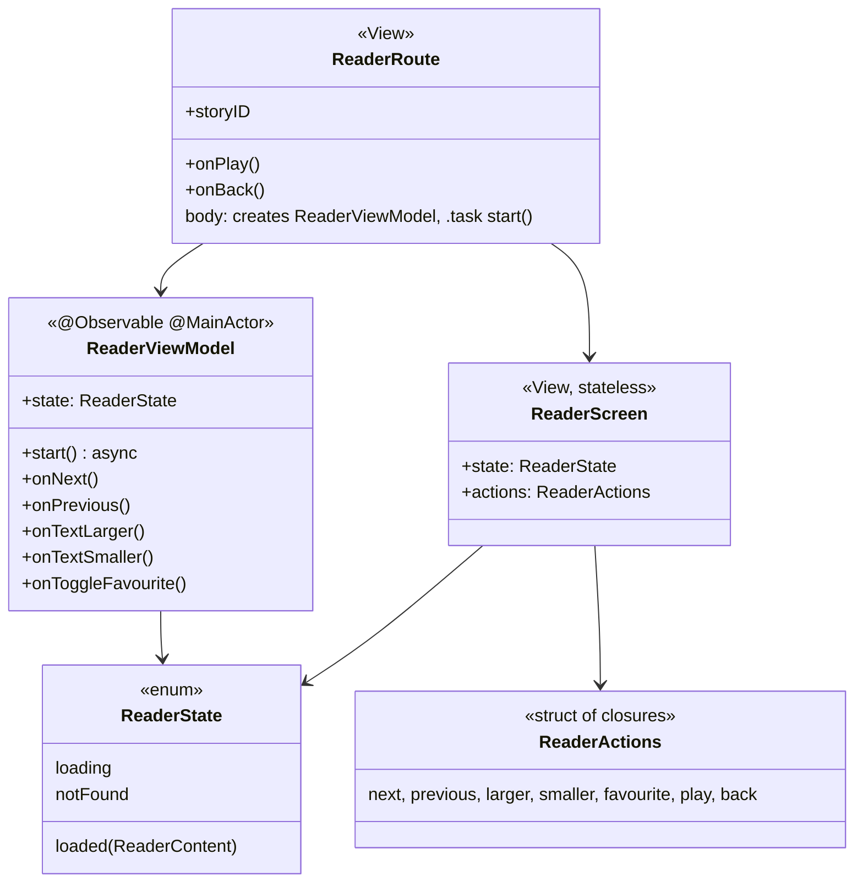

### 5.2 View model template

```swift
@MainActor @Observable
public final class ReaderViewModel {
    public private(set) var state: ReaderState = .loading

    private let storyID: String
    private let stores: StoryStores
    private let browse: BrowseContextProvider
    private let preferences: PreferencesRepository
    private var page = 0

    public init(storyID: String, stores: StoryStores, browse: BrowseContextProvider, preferences: PreferencesRepository) { … }

    /// Called from `.task {}`; cancelled automatically when the view disappears.
    public func start() async {
        for await context in browse.contexts() {
            for await content in combineLatest(stores.lookup.story(id: storyID, context: context),
                                               preferences.reading(),
                                               stores.favourites.favouriteIDs(childKey: context.childKey)) {
                state = ReaderState(content, page: page)
            }
        }
    }

    public func onNext() { move(by: 1) }
    public func onPrevious() { move(by: -1) }
}
```

Rules:

1. `state` is the only stored property the view reads; it is `private(set)`.
2. One public method per user action; no `send(Action)` switch needed.
3. Long-lived observation happens in `start()`, called from `.task`, so SwiftUI cancels it when the screen leaves.
4. Writes are fire-and-forget `Task { await repo.write() }` owned by the view model; the store's stream brings the new value back (single source of truth).
5. Text is `LocalizedStringResource` or an enum; view models never format user-visible strings themselves.
6. Loading spinners appear only after `AppConfig.UI.loadingIndicatorDelay` to avoid flashes.

### 5.3 One-off effects

| Effect | Example | Delivery |
| --- | --- | --- |
| Navigate after work | Generation finished → Story Ready | `AsyncStream<GeneratingEffect>` read by `GeneratingRoute` |
| Apply something outside the screen | Setup picks UI language | `SetupEffect.applyLanguage(tag)` → `Localizer` |
| Reset the app | Data deleted | `PrivacyEffect.deleted` → `AppRouter.resetToOnboarding()` |

---

## 6. Navigation [A-5 HLD]

### 6.1 Types

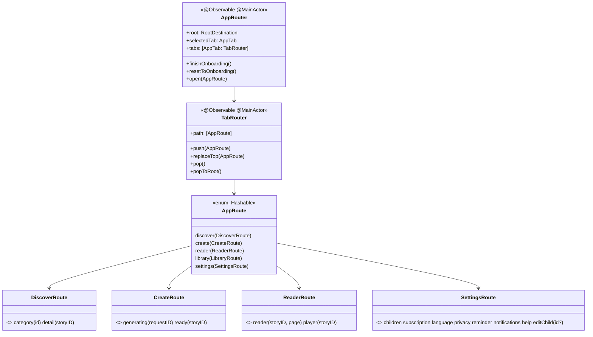

- Each feature exports its own route enum and a `destination(for:)` view builder, plus a `Navigation` struct of closures it needs (`openStory`, `openPlayer`, `back`).
- The app target maps feature closures to router calls, so features never see the router or each other (the Android `AppNavHost` role).
- `RootView` switches on `router.root`: `.onboarding` (Onboarding → Setup in its own stack) or `.main` (TabView).

### 6.2 Rules

| Rule | Implementation |
| --- | --- |
| No double opens on fast taps | `TabRouter.push` ignores a route equal to the current top and taps while a transition is in flight |
| Reader ↔ Player swap | `replaceTop(.reader(.player(id)))` |
| Story Ready back goes to Create root | on `.ready`, path becomes `[.create(.ready(id))]` with Generating removed |
| Generating back pauses first | custom back button: first tap pauses, second leaves |
| Parent-only screens | destination wrapped in `ParentGated { … }` (§9.3) |
| Tab re-select | tapping the active tab calls `popToRoot()` |

---

## 7. Dependency injection and app start [A-6]

### 7.1 Composition root

```swift
@MainActor
final class AppContainer {
    let flags: FeatureFlags
    let preferences: PreferencesRepository
    let catalog: CatalogRepository
    let profiles: ProfilesRepository
    let generation: GenerationRepository
    // … every protocol, created once

    init(environment: AppEnvironment = .live) {
        flags = environment.flags
        let store = try! LittleStore.make(inMemory: environment.inMemoryStore) // only crash point, at launch, by design
        let content = BundleContentSource(bundle: .dataModule)
        preferences = PreferencesRepositoryImpl(store: PreferencesStore(defaults: environment.defaults))
        catalog = CatalogRepositoryImpl(source: content)
        let writer: StoryWriter = TemplateStoryWriter(source: content)          // mock AI
        generation = GenerationRepositoryImpl(writer: writer, library: …, clock: environment.clock)
        …
    }

    func makeReaderViewModel(storyID: String) -> ReaderViewModel { … }  // factories per screen
}
```

- `AppEnvironment` holds `clock`, `defaults`, `flags`, `inMemoryStore`, `gateChallenges`; `.live`, `.preview` and `.uiTest` variants exist.
- UI tests launch with `-uiTest` and get the fixed parental gate, an in-memory store and an immediate clock.
- `ViewModelFactory` protocols per feature are passed to feature roots, so features never see `AppContainer`.

### 7.2 Startup

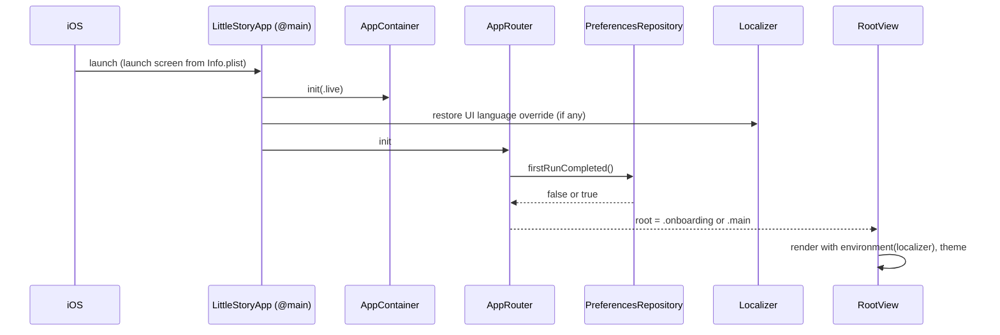

---

## 8. Localization [A-7.6]

### 8.1 Pieces

| Piece | Where | Job |
| --- | --- | --- |
| `Localizable.xcstrings` | each UI target | keys, English source, Kannada translation, plural variants, comments for translators |
| `L10n` keys | generated per target (`Tools/gen-l10n`) | `static let readerNextPage = LocalizedStringResource("reader.next_page", bundle: .module)` so no string literal appears in views |
| `Localizer` | `CoreUI` | `@Observable` holder of the active UI `Locale`; resolves a resource with `String(localized:)` using that locale and the matching `.lproj` bundle; injected into the SwiftUI environment |
| `LText` | `CoreUI` | `Text` wrapper: `LText(L10n.readerNextPage)` reads the `Localizer` from the environment |
| `\.locale` | root view | set from `Localizer` so dates, numbers and `FormatStyle` follow the app language |
| Content language | `PreferencesRepository.contentLanguage()` | drives every catalogue stream |

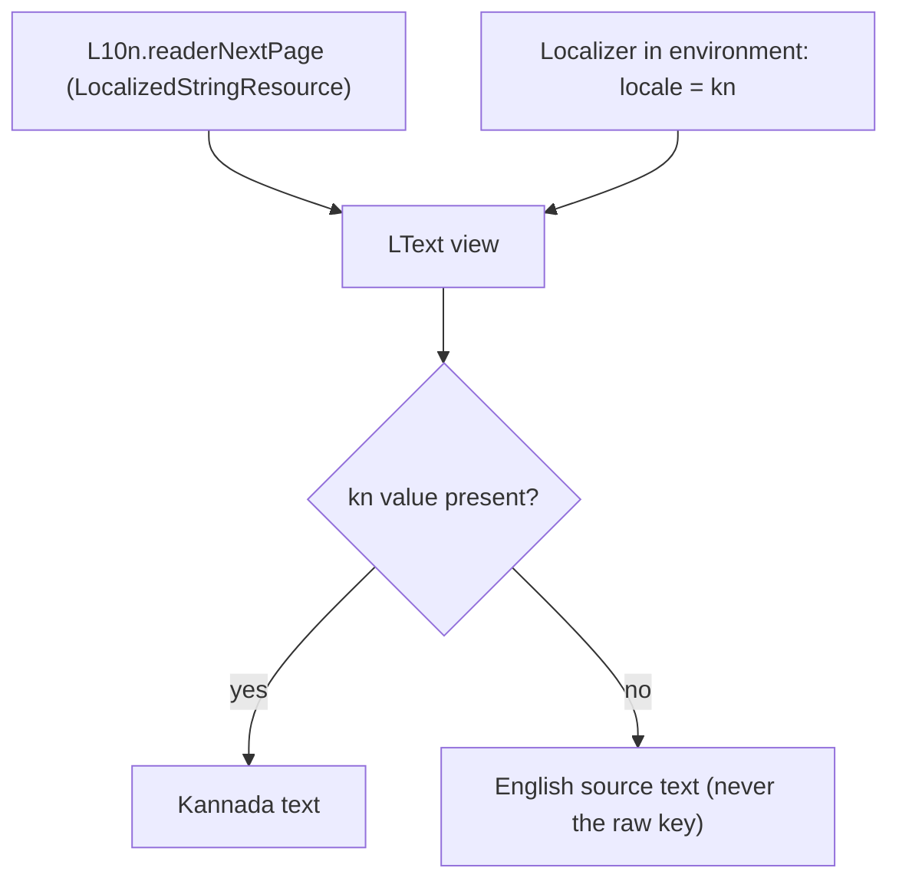

### 8.2 Rules

1. Keys are dotted lower snake case, `feature.screen.element`, and equal the Android string names where one exists (`home_title` ↔ `home.title` via the import tool's mapping table).
2. Arguments are positional (`%1$@`, `%2$lld`); plurals use String Catalog variants (Kannada uses `other` plus `one`).
3. Accessibility labels, hints and values are catalog strings too.
4. Native language names come from `SupportedLanguage.nativeName`, never translated.
5. New Kannada strings are marked `needs_review` in the catalog and **Draft — needs native review** in the workbook.

### 8.3 Adding a language (example: Hindi)

1. Add `SupportedLanguage(tag: "hi", nativeName: "हिन्दी", isEnabled: true)`.
2. Add `hi` to every `.xcstrings` and to `CFBundleLocalizations` in Info.plist.
3. Add `stories_hi.json`, `categories_hi.json`, `generated_hi.json`, `notifications_hi.json` (copied from Android when they exist).
4. Add a Devanagari font if the system font is not enough.
5. Add `hi` to the snapshot matrix. No feature code changes.

---

## 9. Design system, `CoreUI` and adaptive layout [A-10]

### 9.1 Tokens

The tokens are a hand port of Android's `:core:designsystem` theme, with the same names and values (1 CSS px = 1 pt = 1 dp). A generator was dropped because Android's palette also holds colours sampled from the screenshots that are not in `design-tokens.json`.

| File | Contents |
| --- | --- |
| `Palette.swift` | The only colour literals: every `design-tokens.json` colour plus Android's sampled extras |
| `LSColor.swift` | Semantic roles (`primary`, `background`, `textSecondary`, …), story-art gradients by `paletteId`, illustration and tile colours |
| `Dimens.swift` | `LSSpacing`, `LSDimens`, `LSRadius` |
| `LSShadow.swift`, `LSMotion.swift` | CSS shadows (`.lsShadow(_:)`), durations and Reduce Motion aware animations |
| `LSFonts.swift`, `LSTypography.swift` | Bundled variable fonts (DM Sans, Manrope, Noto Sans Kannada, OFL) with the weight set on the `wght` axis; `LSTextStyle` in a Latin and a Kannada set; `.lsTextStyle(_:)` |
| `LSIcon.swift` | The 24 design icons from `Icons.xcassets` (SVG, template, back and chevron mirror right to left) |
| `LSButtons.swift` | `LSPressStyle`, `LSButton` (primary, secondary, ghost), `LSIconButton` |

```swift
Text(HomeStrings.title).lsTextStyle(.homeTitle).foregroundStyle(LSColor.textPrimary)
LSButton(Text(SetupStrings.continue)) { model.continueTapped() }
LSIconButton(.heart, label: Text(ReaderStrings.favourite), active: state.isFavourite) { model.toggleFavourite() }
```

- Typography scales with Dynamic Type through `UIFontMetrics` for the style's text style, so a 29 pt title grows like `.largeTitle`. The language, not the device, picks the set: Kannada uses Noto Sans Kannada, line heights of at least 1.4, no negative tracking, no upper-casing and labels of at least 11 pt.
- One light theme with night surfaces (Android ADR-013): the root sets `.preferredColorScheme(.light)` until a dark palette is designed.
- `Tools/check-tokens.py` (CI) fails when a design colour is missing from `Palette.swift`, a colour literal appears elsewhere, an icon and `LSIcon` disagree, or a font has no licence.

### 9.2 Components

| Component | Target | Notes |
| --- | --- | --- |
| `LSButton` (primary, secondary, text) | DesignSystem | min 44 pt, pressed state, loading state |
| `LSChip`, `LSSelect`, `LSTextField`, `LSToggleRow` | DesignSystem | labels from the caller, character counter for prompt |
| `LSBanner`, `LSToast`, `LSNotesBanner` | DesignSystem | simulation labels use `LSNotesBanner` |
| `TopBar`, `LSTabBarItems` | CoreUI | |
| `StoryCard`, `StoryRow`, `StoryArt` (Canvas), `Avatar` | CoreUI | art drawn from `StoryArtSpec`, decorative, hidden from VoiceOver |
| `LoadingView` | CoreUI | delayed appearance |
| `NotFoundView`, `EmptyStateView` | CoreUI | |
| `ParentGated`, `ParentalGateSheet` | CoreUI | §9.3 |

### 9.3 Parental gate [A-7.7]

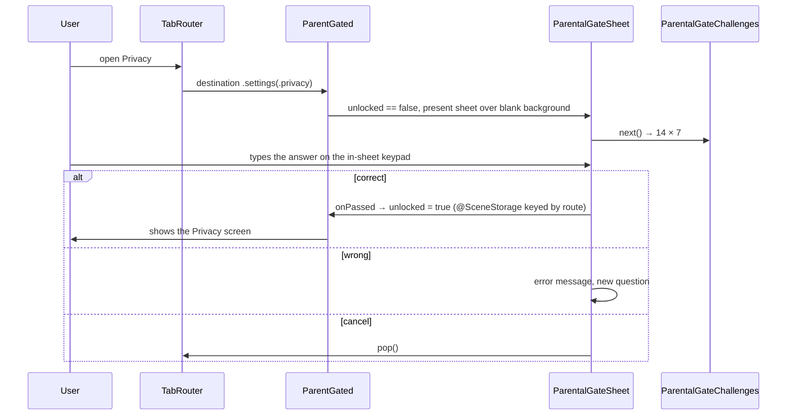

- The keypad is custom (digits only), so a child cannot paste or dictate the answer, and it matches Android.
- Also used before any external link (Help → website) and any future purchase, per App Store guideline 1.3.

### 9.4 Adaptive layout (iPhone and iPad)

**Info.plist and target settings**

| Setting | Value | Why |
| --- | --- | --- |
| `TARGETED_DEVICE_FAMILY` | `1,2` | iPhone and iPad |
| `UISupportedInterfaceOrientations` | portrait, landscape left, landscape right | iPhone |
| `UISupportedInterfaceOrientations~ipad` | all four | iPad |
| `UIRequiresFullScreen` | not set (false) | allows Split View, Slide Over, Stage Manager, resizable windows |
| `UIApplicationSceneManifest` → `UIApplicationSupportsMultipleScenes` | false in MVP | one window; can be turned on later |

**Types**

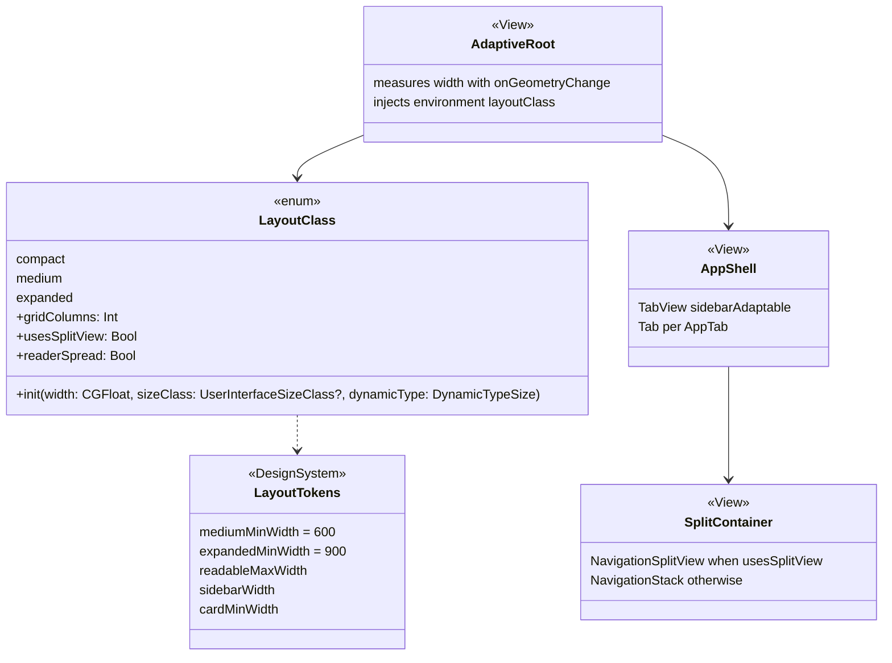

```swift
public enum LayoutClass: Sendable, Equatable {
    case compact, medium, expanded

    public init(width: CGFloat, sizeClass: UserInterfaceSizeClass?, dynamicType: DynamicTypeSize) {
        // Very large text gets more room per item: drop one class so Kannada at AX sizes never truncates.
        let base: LayoutClass = switch width {
            case ..<LayoutTokens.mediumMinWidth: .compact
            case ..<LayoutTokens.expandedMinWidth: .medium
            default: .expanded
        }
        self = (dynamicType.isAccessibilitySize && base != .compact) ? base.smaller : base
        if sizeClass == .compact { self = .compact }
    }

    var smaller: LayoutClass { self == .expanded ? .medium : .compact }

    public var gridColumns: Int { switch self { case .compact: 1; case .medium: 2; case .expanded: 3 } }
    public var usesSplitView: Bool { self != .compact }
    public var readerSpread: Bool { self == .expanded }
}

struct AdaptiveRoot<Content: View>: View {
    @Environment(\.horizontalSizeClass) private var sizeClass
    @Environment(\.dynamicTypeSize) private var typeSize
    @State private var width: CGFloat = 0
    let content: Content

    var body: some View {
        content
            .environment(\.layoutClass, LayoutClass(width: width, sizeClass: sizeClass, dynamicType: typeSize))
            .onGeometryChange(for: CGFloat.self, of: \.size.width) { width = $0 }
    }
}

struct AppShell: View {
    @Bindable var router: AppRouter
    var body: some View {
        TabView(selection: $router.selectedTab) {
            Tab(value: AppTab.home) { HomeRoot() } label: { TabLabel(.home) }
            Tab(value: AppTab.discover) { DiscoverRoot() } label: { TabLabel(.discover) }
            // Create, My Stories, Profile …
        }
        .tabViewStyle(.sidebarAdaptable)   // tab bar on iPhone, sidebar on iPad
    }
}
```

**Rules for every screen**

1. Read `@Environment(\.layoutClass)`; never check `UIDevice.current.userInterfaceIdiom` for layout.
2. Grids use `LazyVGrid(columns: [GridItem(.adaptive(minimum: LayoutTokens.cardMinWidth))])` so the column count follows the window.
3. Text blocks are wrapped in `.frame(maxWidth: LayoutTokens.readableMaxWidth)`.
4. Features with list + detail (Discover, My Stories, Settings) use `SplitContainer`; the router keeps one selection, so rotating or resizing keeps the open story.
5. Reader in `.expanded` shows pages `n` and `n + 1`; Next moves by two; progress still stores the left page.
6. Sheets use `.presentationSizing(.form)` on iPad so dialogs (parental gate, confirmations) are not full screen.
7. Keyboard: `.keyboardShortcut` for Next / Previous page (arrow keys), Play / Pause (space), Search (⌘F); menu bar commands on iPadOS 26.
8. Pointer: `.hoverEffect()` on cards and buttons.
9. Every screen ships previews and snapshots for compact and expanded.

**How navigation changes with width**

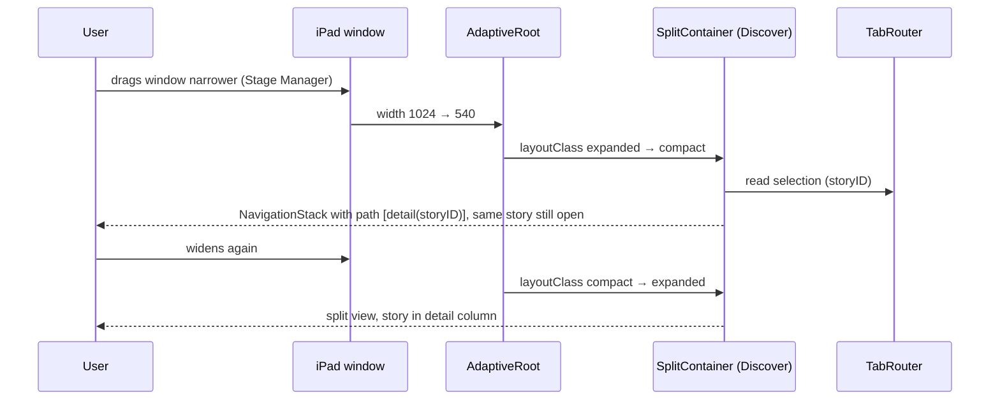

---

## 10. Key flows [A-7]

### 10.1 First run

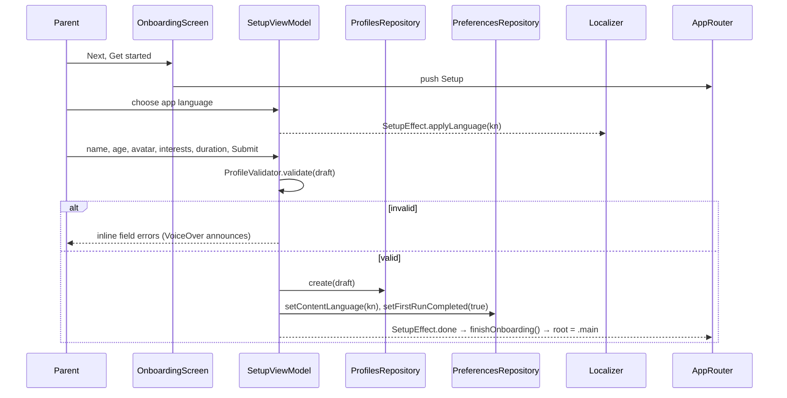

Skip writes only `firstRunCompleted = true`; the app then browses as the guest.

### 10.2 Create a story (mocked AI)

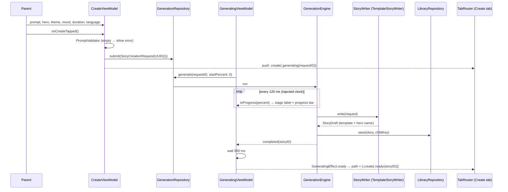

| Case | Behaviour |
| --- | --- |
| User closes Generating | task cancelled, `paused = true`, **Try again** restarts at 8 % |
| Back from paused | returns to Create with the prompt intact |
| App terminated mid-generation | request was in memory only → `.failed(.unknownRequest)` → paused, "Back to your idea" |
| Writer throws (future real AI) | `.failed(.writer(error))` → paused with retry; error text from catalog |

### 10.3 Reader

- `state = loading | notFound | loaded(ReaderContent)`; `notFound` covers a missing story or one without pages.
- `onNext` / `onPrevious` clamp to the page range and upsert progress, keeping `listenFraction`.
- Text size steps by 0.1 within 0.9…1.3, rounded to tenths, saved in preferences; applied on top of Dynamic Type.
- Play replaces Reader with Player.

### 10.4 Player

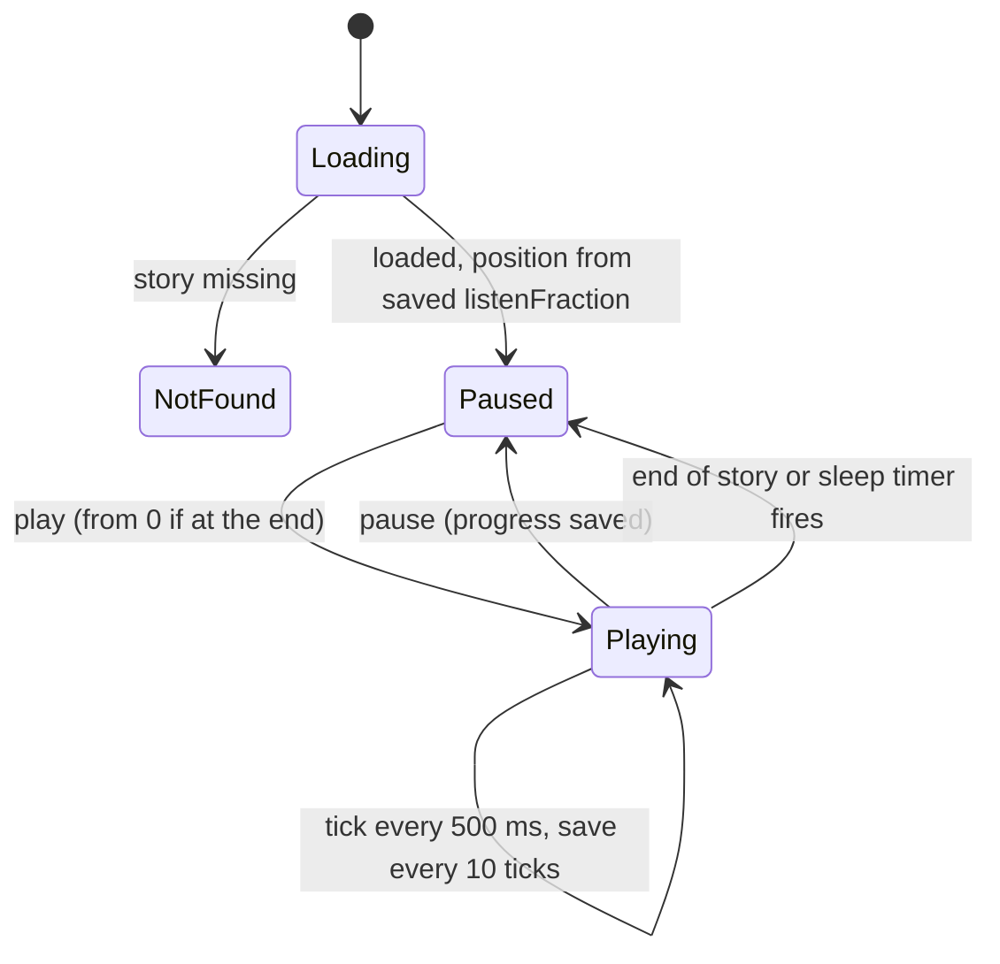

- The tick loop runs in a view-model-owned `Task` using the injected clock.
- `Narrator` events drive position when a real narrator exists; with `SimulatedNarrator` the same events come from the timer, so the view model has one code path.
- The screen keeps the device awake only while playing (`isIdleTimerDisabled`), and restores it on pause or exit.

### 10.5 Language switch

| What | Stored in | Changed by | Effect |
| --- | --- | --- | --- |
| UI language | `ui_language_tag` + `Localizer` | Language screen, Setup | every `LText` and formatter re-renders instantly |
| Story language | `content_language_tag` | Language screen, Setup, Create (per request) | `BrowseContext.languageTag` changes, catalogue streams re-emit |

### 10.6 Delete all local data

Privacy → confirm dialog → `PrivacyViewModel.onConfirmDelete()` → `LocalDataRepository.deleteAll()` → `PrivacyEffect.deleted` → `Localizer.reset()` → `AppRouter.resetToOnboarding()` (all tab paths cleared).

---

## 11. Error handling [A-8]

| Failure | Handled in | User sees |
| --- | --- | --- |
| Mock JSON missing or malformed | `ContentResolver` (`try?` per file, logged) | English content; empty list only if the English file is broken (caught by tests) |
| Missing translated field | `ContentResolver` | that field in English |
| Unknown story id | `StoryLookup` returns nil | Not Found state with Back |
| Created story pages unreadable | record mapper | no pages → Not Found |
| Unknown generation request | `GenerationRepositoryImpl` | paused, "Back to your idea" |
| Empty or long prompt | `PromptValidator` | inline error, announced to VoiceOver |
| Invalid profile | `ProfileValidator` | inline field errors |
| Wrong gate answer | `ParentalGateChallenge` | error and a new question |
| Store cannot open at launch | `AppContainer` | one retry with a fresh store after moving the old file aside; logged |

Errors are typed (`enum XError: Error`) and use Swift 6 typed throws where they cross a protocol. Future network errors follow the Android `error-handling.md` model (`offline`, `timeout`, `server`, `unauthorised`).

---

## 12. Screen catalogue [A-9]

| Screen | Target · route | View model inputs | State · effects |
| --- | --- | --- | --- |
| Onboarding (01) | Onboarding · root | — | `OnboardingState(page)` · `finished` |
| Setup (02) | Onboarding · `.setup(childID?)` | Profiles, Preferences | `SetupState` · `applyLanguage`, `done` |
| Home (03) | Home · tab root | Catalog, Favourites, BrowseContext, Progress | `HomeState` (resume, featured, categories) |
| Discover (04) | Discover · tab root | Catalog, Favourites, BrowseContext, SearchStories | `DiscoverState` (query, filter, results) |
| Category (05) | Discover · `.category(id)` | Catalog, Favourites, Downloads, BrowseContext | `CategoryState` (sort) |
| Story Detail (06) | Discover · `.detail(storyID)` | StoryLookup, Favourites, Downloads | `StoryDetailState` |
| Create (07) | Create · tab root | Profiles, Preferences, Generation | `CreateState` · `startGeneration` |
| Generating (08) | Create · `.generating(requestID)` | Generation | `GeneratingState` · `ready` |
| Story Ready (09) | Create · `.ready(storyID)` | Library, Favourites, Downloads | `StoryReadyState` |
| Reader (10) | Reader · `.reader(storyID, page)` | StoryStores, Preferences | `ReaderState` |
| Player (11) | Reader · `.player(storyID)` | StoryStores, Preferences, Narrator | `PlayerState` |
| My Stories (12) | Library · tab root | StoryStores | `MyStoriesState(tab)` |
| Downloads (13) | Library · `.downloads` | Catalog, Library, Downloads | `DownloadsState` |
| Profile (14) | Settings · tab root | Profiles, Preferences, FeatureFlags | `ProfileState` |
| Subscription (15) 🔒 | Settings · `.subscription` | Subscription | `SubscriptionState` |
| Child profiles (16) 🔒 | Settings · `.children` | Profiles | `ChildProfilesState` |
| Reminder (17) | Settings · `.reminder` | Preferences | `ReminderState` (nothing scheduled) |
| Notifications (18) | Settings · `.notifications` | Notifications | `NotificationsState` |
| Launch (19) | Info.plist `UILaunchScreen` | — | — |
| Language (20) 🔒 | Settings · `.language` | Preferences, Localizer | `LanguageState` |
| Privacy (21) 🔒 | Settings · `.privacy` | LocalData, FeatureFlags | `PrivacyState` · `deleted` |
| Help (22) | Settings · `.help` | AppInfo | — |

Each screen has an `XAccessibilityID` enum (`ReaderAccessibilityID.nextPage`) used by UI tests, the iOS twin of Android `XTags`.

---

## 13. Testing [A-11]

### 13.1 Seams

| Seam | Used by tests to |
| --- | --- |
| Repository protocols + `TestSupport` fakes | drive view models with any data |
| `MockContentSource` | feed real and broken JSON to the resolver |
| `any Clock<Duration>` | run generation and playback instantly (`TestClock.advance(by:)` from swift-clocks) |
| `UUID` and `Date` providers | deterministic ids and times |
| `XScreen(state:actions:)` | snapshot any state without a view model |
| `AppEnvironment.uiTest` | in-memory store, fixed gate, immediate clock for XCUITest |

### 13.2 Examples

```swift
@Test("Generation reaches 100 and saves exactly one story")
func generationCompletes() async throws {
    let clock = TestClock()
    let library = FakeLibraryRepository()
    let repo = GenerationRepositoryImpl(writer: TemplateStoryWriter(source: .fixtures), library: library, clock: clock)
    let id = await repo.submit(.fixture(heroName: "Asha"))
    let states = Task { await repo.generate(id: id, startPercent: 0).collect() }
    await clock.advance(by: .seconds(5))
    #expect(await states.value.last == .completed(storyID: "generated_\(id)"))
    #expect(await library.saved.count == 1)
}

@Test("Kannada field missing falls back to English", arguments: ["title", "synopsis", "pages"])
func fallback(field: String) async { … }
```

### 13.3 Snapshot matrix

| Axis | Values |
| --- | --- |
| Language | en, kn |
| Dynamic Type | large (default), AX5 (Kannada only, iPhone 17 and iPad Air, to keep the count down) |
| Device | iPhone 17 (compact), iPhone SE 3rd gen (smallest), iPhone 17 landscape, iPad Air 11-inch portrait (medium), iPad Pro 13-inch landscape (expanded), iPad half split (compact on iPad) |
| Appearance | light (night screens are their own design) |

Baselines live in `__Snapshots__/`, are recorded on the CI simulator image only, and are approved by the owner.

### 13.4 UI journeys (XCUITest)

1. First run in English: onboarding → setup → home shows the child's name.
2. First run in Kannada: same, every visible label is Kannada.
3. Create a story → generating → ready → read two pages → play.
4. Favourite on Detail shows on My Stories.
5. Switch UI and story language without restart.
6. Parental gate blocks Privacy; delete all data returns to onboarding.
7. iPad: sidebar navigation, Discover split view opens Detail in the detail column, Reader shows a two-page spread in landscape, rotating keeps the current page.

---

## 14. Tooling and CI

### 14.1 Scripts (`Tools/`, Swift scripts or shell, all free)

| Tool | Does |
| --- | --- |
| `check-dependencies` | fails on imports outside §1.3 |
| `check-hardcoding` | fails on `Text("…")` literals, `Color(red:…)`, raw numbers in padding/frame, `.font(.system(size:))` outside DesignSystem |
| `check-translations` | parses every `.xcstrings`: each key has `en` and `kn`, placeholders match, no empty values |
| `check-tokens` | `design-tokens.json` colours present in `Palette.swift`; icons match `LSIcon`; font licences present |
| `convert-icons` | Android `ic_*.xml` → `Icons.xcassets` SVGs (run when an Android icon changes) |
| `gen-l10n` | `.xcstrings` → `L10n` key constants |
| `import-android-strings` | Android `strings.xml` (values, values-kn) → `.xcstrings` with mapped keys |
| `sync-android-content` | copies mock JSON from a checkout of the Android repo and diffs it |

### 14.2 `ci.yml` (shape)

```yaml
name: CI
on:
  pull_request: { branches: [development, staging, main] }
  push: { branches: [development, staging, main] }
permissions: { contents: read }
jobs:
  verify:
    runs-on: macos-26              # arm64; free for public repositories
    steps:
      - uses: actions/checkout@v7
      - name: Select Xcode 27.2 (runner default is 26.6)
        run: sudo xcode-select -s "/Applications/Xcode_$(cat .xcode-version).app"   # .xcode-version = 27.2
      - name: Lint tools at pinned versions
        run: Tools/install-lint-tools.sh   # SwiftLint 0.65.1, SwiftFormat 0.64.6 (pinned release binaries)
      - run: swiftformat --lint . && swiftlint --strict
      - run: swift Tools/check-dependencies.swift && swift Tools/check-hardcoding.swift && swift Tools/check-translations.swift
      - run: >
          xcodebuild test -scheme LittleStory
          -destination 'platform=iOS Simulator,name=iPhone 17'
          -destination 'platform=iOS Simulator,name=iPad Air 11-inch (M3)'
          -enableCodeCoverage YES -resultBundlePath TestResults
      - uses: actions/upload-artifact@v7
        if: always()
        with: { name: test-results, path: TestResults.xcresult }
```

Versions above are the newest stable on 11 Nov 2026. Simulator names are checked against `xcrun simctl list` on the runner at kick-off. If the `macos-26` image does not yet carry Xcode 27.2, the job uses the `xcode-27` runner label. No secrets are used.

---

## 15. Coding conventions

1. Swift API Design Guidelines; types `UpperCamelCase`, members `lowerCamelCase`, acronyms uniform (`storyID`, `URL`).
2. One primary type per file; file name equals type name.
3. `public` only on what other targets need; everything else `internal` or `private`.
4. Value types by default; classes only for `@Observable` view models, routers and `@Model` records.
5. No force unwraps or `try!` outside `AppContainer` launch (lint rule).
6. No singletons (`static let shared`) except `Logger` categories.
7. No `print`; use `Logger` with privacy `.private` for any user data.
8. Every public protocol has a fake in `TestSupport`.
9. Previews use `XScreen` with fixture state in EN and KN.
10. A PR adds tests with the change and passes all gates locally (`make verify` wraps the CI steps).

---

## 16. Extension recipes

| Change | Touch only |
| --- | --- |
| New screen | route case + view + view model + state + strings (en, kn) + accessibility IDs + tests + snapshots in the owning feature; one mapping line in the app router |
| New language | §8.3 |
| New content source (backend) | new `CatalogRepository` implementation in `Data`; one line in `AppContainer` |
| Real AI writer | new `StoryWriter` implementation behind `FeatureFlags`; parental consent and moderation first (Android `families-compliance` notes) |
| On-device voice | `SpeechNarrator: Narrator` over `AVSpeechSynthesizer`; check Kannada voice availability per device, fall back to `SimulatedNarrator` |
| Accounts | new `FeatureAccount` target and `AuthRepository` protocol, following Android PR #20 |
| New setting | key in `PreferencesStore` + property on `PreferencesRepository` + UI in Settings |

---

## Appendix A. Android → iOS mapping

| Android | iOS |
| --- | --- |
| Gradle modules + `build-logic` | Swift package targets + `check-dependencies` |
| Hilt `@Inject`, `@HiltViewModel` | constructor injection, `AppContainer` factories |
| `ViewModel` + `StateFlow` | `@Observable @MainActor` class + `state` property |
| `collectAsStateWithLifecycle` | `.task { await vm.start() }` |
| `Channel` effects | `AsyncStream<Effect>` |
| `Flow`, `combine`, `flatMapLatest` | `AsyncStream`, `combineLatest` (AsyncAlgorithms), task restart |
| `kotlinx-coroutines-test` virtual time | injected `Clock` + `TestClock` |
| Navigation Compose typed routes | `NavigationStack` + `Hashable` route enums |
| Room + DAOs | SwiftData `@Model` + `@ModelActor` (GRDB fallback) |
| DataStore | `UserDefaults` actor |
| assets JSON + kotlinx.serialization | bundle resources + `Codable` |
| `strings.xml` + `values-kn` | `.xcstrings` with `en` and `kn` |
| `UiText` | `LocalizedStringResource` + `LText` |
| `AppCompatDelegate.setApplicationLocales` | `Localizer` override + system per-app language page |
| Compose `Canvas` story art | SwiftUI `Canvas` |
| Robolectric + Compose UI tests | Swift Testing view model tests + XCUITest |
| Roborazzi screenshots | swift-snapshot-testing |
| Detekt, ktlint, Lint, Kover | SwiftLint, SwiftFormat, `xccov` coverage gate |
| `testTag` / `XTags` | `accessibilityIdentifier` / `XAccessibilityID` |

## Appendix B. Proposed ADRs for the iOS repo

| ADR | Decision |
| --- | --- |
| ADR-iOS-001 | Native Swift + SwiftUI, not KMP or Compose Multiplatform |
| ADR-iOS-002 | One local package, target per layer and feature, enforced imports |
| ADR-iOS-003 | MVVM with `@Observable`, one state struct, method per action; no TCA |
| ADR-iOS-004 | SwiftData behind repositories; GRDB fallback |
| ADR-iOS-005 | Constructor injection with a composition root; no DI framework |
| ADR-iOS-006 | String Catalogs + `Localizer` in-app language override |
| ADR-iOS-007 | Shared contracts with Android (content JSON, tokens, keys, test IDs) |
| ADR-iOS-008 | Mocked AI behind `StoryWriter`, `Narrator`, `Illustrator` |
| ADR-iOS-009 | Minimum iOS / iPadOS 26; build with Xcode 27.2 and the iOS 27.2 SDK |
| ADR-iOS-011 | One universal iPhone + iPad app with layout classes (compact, medium, expanded), sidebar-adaptable tabs and split views |
| ADR-iOS-010 | Swift Testing + swift-snapshot-testing + XCUITest; owner-approved baselines |
